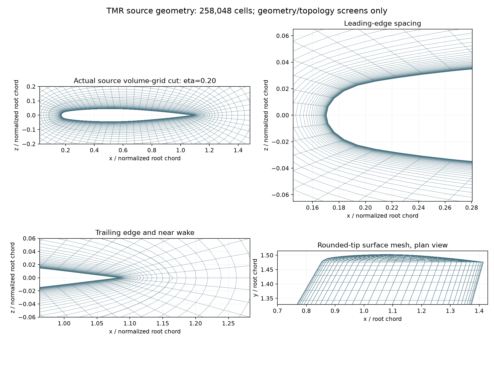
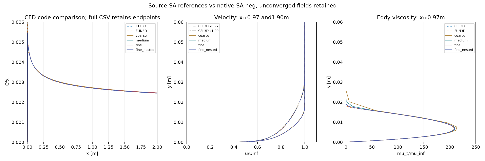

# 25Ekim2026 —CFD ve güvenilirlik sonuçları

**Genel M6/CFD yeterliliği false.** Yerel testler ve yayın sürümü fiziksel yeterlilikten ayrıdır. Bu özet GitHub’da doğrudan okunur; ayrıntılı HTML, JSON ve CSV özgün uygulama yollarındadır.

## ONERA M6

TMR’nin özgün Fortran üreteciyle kaynak keskin firar kenarlı normalize M6 ailesi üretildi. Eski küt firar kenarlı vaka ile geometri/Re/T/SA varyantı aynı değildir; nedensel iyileşme gibi kıyaslanmaz. Kaynak koşullar M0,84/alfa3,06°/Re_root14,6M/T300K; standart SA-neg.

| Ağ | Hücre | Alan / son geçmiş | log yoğunluk | Cp RMSE,271 nokta | Birleşik kabul |
|---|---:|---:|---:|---:|---|
| coarse | 4032 | 3999 / 3999 | -6.081211 | 0.289875 | Geçmedi |
| medium | 32256 | 2400 / 2539 | -5.116083 | 0.153477 | Geçmedi |
| fine | 258048 | 600 / 663 | -1.754011 | 0.311580 | Geçmedi |

İnce çözüm yakınsamadı; GCI=null. MG2 ve kaba→orta ilk tahmin aktarımı dar artık düşüşü ekranını geçti; LINELET geçmedi. Bunlar doğruluk veya süre hızlanması kanıtı değildir. Katıya uzaklık/yüzeye uzaklık karışıklığı analitik küp karşı örneğiyle düzeltildi; önceki hatalı ölçümler korundu.

[Tam HTML rapor](../../uygulama/outputs/reports/tmr_m6_kaynak_ve_yontem_20261025.html) · [JSON karşılaştırma](../../uygulama/outputs/projects/proje-e9319baef1/reports/tmr_source_case_review_20261025.json)

## Düz plaka SA-neg uygulama teşhisi

NASA TMR kaynak ağları SU2 biçimine koordinatları bit düzeyinde koruyarak çevrildi. M0,2/Re_per_m5M/T300K;2m adyabatik duvar. Kaynak CFD kodları CFL3D/FUN3D’dir; deneysel kıyas değildir.

| Deneme | Hücre | Alan / son geçmiş | log yoğunluk | Yerel Cf farkı: CFL3D / FUN3D | İteratif kapı |
|---|---:|---:|---:|---:|---|
| coarse | 3264 | 400 / 400 | -13.035935 | %0.2511 / %1.4925 | Geçti |
| medium | 13056 | 3600 / 3716 | -9.470850 | %0.1528 / %0.4863 | Geçmedi |
| fine | 52224 | 2000 / 2015 | -8.307791 | %0.3815 / %0.4652 | Geçmedi |
| fine_nested | 52224 | 800 / 925 | -9.366385 | %0.1112 / %0.1946 | Geçmedi |

Yerel Cf aynı kaynak hücre sayısıyla kıyaslandı. Kaynak en ince ağın Cf eğrisi, iki hız ve μt profili ekranları yakın olsa da orta/ince yakınsaması yok. Kaba ağın geçmesi aile kabulü değildir. Boyutlu gaz/Sutherland sabitlerinin bütün kaynak kodlarla tam özdeşliği ayrıca kurulmuş değildir.

ILU aynı checkpointle yalnız0,055log ek düşüş sağladı, önceden kayıtlı0,3eşiğini geçmedi. Orta→ince pozitif başlangıç aktarımı400adımda2,57747log ek yoğunluk düşüşü verdi; son iteratif kabul yine geçmedi. Daha iyi referans uyumu nedeniyle ana fine rolü değiştirilmedi.

Hız örneklemev2, iki native sütun arasında tam istenen x’de interpolasyon yapar; en yakın sütunla eski48son işlem dosyası korunur. Kaynak metnindeki2e−12m yuvarlamanın eğrilik olduğu teşhisi çürütülüp kayıtta tutuldu. Üç hatalı aktarım taslağı native öncesi reddedildi.

[Tam HTML rapor](../../uygulama/outputs/reports/cfd_duz_plaka_ve_m6_20261025.html) · [Tüm sayısal farklar](../../uygulama/outputs/reports/flatplate_comparison_20261025.json) · [230 hash kaydı denetimi](../../uygulama/outputs/reports/flatplate_integrity_20261025.json)

## Güvenilirlik ve ajan kapsamı

- R01: sarmalayıcı hatasında aynı native işi ikinci kez başlatmadan PID/yol/oluşturma zamanı ve gerçek çıkış koduyla kurtarma.
- R02: yerel Hessian prototipinde hücre/şablon desteği, koşul ve iki ölçek tutarlılığı. Tam anizotropik remesher/adjoint/hata bandı değildir.
- R03: tek değişkenli neden sınaması; önceden seçilen etki yoksa gerekçesiz değer taraması yapmama.
- L10: standart SA-neg config bağımlılığı. L11: katıya uzaklığı yüzey eşdeğerliği saymama.8/8 araç ve39/39 kayıt kontrolleri; yeni LLM davranışı/uzmanlık kanıtı değildir.

[Güvenilirlik kaynak ve yöntem açıklaması](../../uygulama/work/reliability/README.md) · [Literatür araştırması](../../uygulama/outputs/reports/cfd_dogrulugu_literatur_20261025.html)

## Sıradaki kayıtlı iş

Aynı ince başlangıçla adaptasyon kapalı sabitCFL100/10 karşılaştırması hazır, **henüz çalıştırılmadı**.400adım/240s sınırı, yoğunlukta≥0,3log kazanç ve SA kötüleşmeme ölçütü korunur. [Sözleşme](../../uygulama/outputs/simulations/flatplate_SAneg_20261025_v1/next_numerical_control_not_run.json).

## Kaynaklar

[NASA TMR M6 ağları](https://tmbwg.github.io/turbmodels/onerawingnumerics_grids.html) · [TMR SA-neg kıyası](https://tmbwg.github.io/turbmodels/onerawingnumerics_val_sa.html) · [TMR düz plaka](https://tmbwg.github.io/turbmodels/flatplate.html) · [TMR düz plaka SA sonuçları](https://tmbwg.github.io/turbmodels/flatplate_sa.html)
