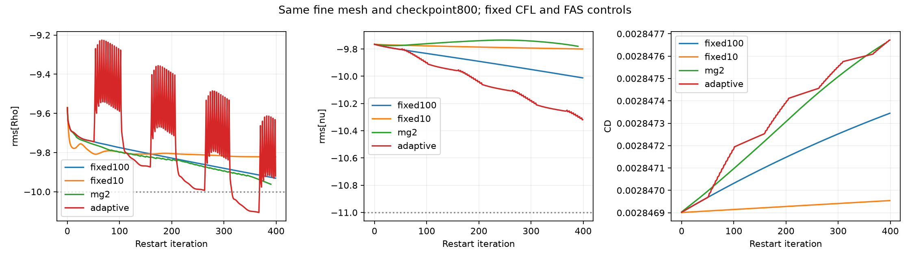

# CFD yakınsama araştırması: kontrollü yöntemler ve birim denetimi

25 Ekim 2026 · 11 yeni native SU2 koşusu · Genel fizik kabulü **false**.

Bu turda bir yakınsama çözümü bulunmadı. Küçük CFD kod kıyaslarında yerel uyum, yakınsama eksikliğiyle birlikte raporlandı. M6, RAE2822 ve gerçek İHA kabulleri kapanmadı.

## Gerçekte sınananlar

| Kontrollü değişiklik | Yoğunluk kazancı, log10 | SA kötüleşmesi, log10 | Ön kayıtlı etki |
|---|---:|---:|---|
| CFL100→10 | -0.108496 | +0.211850 | Geçmedi |
| MG0→2 | — | — | Ölçülemedi: alan200, geçmiş390 |
| Otomatik→sabit CFL | +0.010749 | +0.307025 | Geçmedi |
| Newton / soğuk başlangıç | +0.233026 | +0.414955 | Geçmedi |
| Yalnız değişken ölçekleme | +0.055043 | -0.042092 | Geçmedi |
| Newton / gelişmiş alan | -0.000193 | -0.004318 | Geçmedi |

Kazanç pozitifse ikinci yöntemin yoğunluk kalıntısı daha düşüktür; SA kötüleşmesi pozitifse türbülans kalıntısı daha yüksektir. Eşikler yoğunlukta en az0,3log iyileşme ve SA'da en fazla0,1log kötüleşmeydi. Bu etki testi fiziksel yeterlilik değildir. Her kıyasın koşulları ayrı sözleşmede sabitlendi; yöntemlerin farklı başlangıçlarını birbirine karşı başarı sıralaması yapmadık.

MG2 koşusu240s sınırında390. geçmiş satırında durdu. Son tam alan200. adımdadır; bu alana390/399 kalıntısı atanmadı ve399 etkisi hesaplanmadı. MG'nin çalışması süre bütçesinde tamamlanamadı; bu tek başına yöntemin işe yaramadığını kanıtlamaz.

## En önemli güvenilirlik düzeltmesi

Yalnız boyutsuzlaştırma kıyasında ham sayıları karıştırsaydık yoğunlukta **2.719195log** kazanç görünecekti. Aynı SI kalıntı tanımına çevrilince gerçek fark **0.055043log** kaldı ve0,3log eşiğini geçmedi. Yeni denetçi birimlendirme kanıtı eksik veya farklıysa karşılaştırmayı reddeder.

Restart dönüşümü kaynak koordinatlarını bit düzeyinde korudu; yoğunluk/hız/basınç SI geri dönüş farkı en çok2,55e-16 bağıl mertebesindeydi. Kaynak binary ve dönüştürülmüş binary ayrı SHA256 ile tutulur; aynı fiziksel başlangıç farklı byte dizisi olarak açıkça kaydedildi. Bu dönüşüm yalnız bu7-alanlı2B ideal gaz/SA biçimi ve1m referans uzunluğu için sınandı.

Analitik dönüşüm ve bozuk girdi için4 kontrol, eşli karşılaştırma için13 karşı örnek geçti. Gerçek native beş kalıntının tam özdeşliği için ilk taslakta kullanılan gerekçesiz1e-5log sınırı zayıf düşey momentumda2,31e-5log farkla geçmedi. Taslak korundu; yerine gevşetilmiş bir geçme sınırı konmadı. Bu gözlem fiziksel kabulü değiştirmedi.

## Yeni yöntem gerçekten kullanıldı mı?

SU2v8.5.0'ın resmî örneğindeki `NEWTON_KRYLOV` anahtarı iki ayrı on/off çiftinde kullanıldı. Kaynak kodu, Jacobian-vektör çarpımının sonlu farkla hesaplandığını gösteriyor; ek `_AD` programı gerekmedi. Bu uygulama ortalama akış denklemleri içindir; SA ayrı çözülür. Tam bağlı akış+SA, adjoint veya makaledeki artık yumuşatmalı Newton uygulaması değildir.

Soğuk çiftte iki kolun ilk20 geçmiş kaydı aynıydı. Newton'a özgü200 başlangıç adımı resmî örnekten korundu. Gelişmiş alan çiftinde başlangıç gecikmesi iki kolda da0 olarak kaydedildi. Bu iki çiftin farkını yalnız başlangıcın nedensel etkisi saymadık. Her iki on/off çiftinde kayıtlı ortak etki geçmedi; Newton yöntemini genel olarak başarısız ilan etmiyoruz.

Kaynak kodunda ayrıca kaba MG seviyelerinin CFL ve sönüm katsayılarını kendiliğinden değiştirdiği görüldü. Ana `CFL_ADAPT=NO` seçeneği bütün MG seviyelerini sabitlemiyor. Ön sözleşmedeki0,5 sönüm değerleri başlangıç değerleridir; sonradan bulunan açıklama ayrı kayda eklendi, özgün sözleşme değiştirilmedi.

## Alan ve kaynak sonuçları

Kaynak Cf eğrisi, iki hız profili ve türbülans viskozitesi profilleri bütün noktaları ve geçerlilik maskeleriyle CSV'ye çıkarıldı. Yeni olgun başlangıçlı kontrol alanları yerel kod kıyası ekranlarını geçti; bütün yeni alanlarda iteratif kabul açık kaldı. Soğuk Newton alanında Cf/hız/viskozite ekranları da geçmedi. Çözüme uysun diye kaynak nokta, fizik, ağ veya kabul eşiği değiştirilmedi.

Gelişmiş orta ağ Newton alanının SI yoğunluk kalıntısı−9,9730285:−10 eşiğini **geçmez**.−10'a yuvarlayarak kabul etmedik. Son100CD aralığı8,66e-10 ve maxy+0,482214 olması bu eksikliği kapatmıyor. Bu yerel kod kıyası deney doğrulaması veya3B kanat yeterliliği değildir.

## Kaynak araştırmasından seçilen sonraki iş

[SU2 doğrusal çözücü rehberi](https://su2code.github.io/docs_v7/Linear-Solvers-and-Preconditioners/), iç doğrusal çözümü aşırı sıkı çözmenin toplam ilerlemeyi yavaşlatabileceğini açıklıyor. Sıradaki tek deney, aynı gelişmiş orta ağ alanında yalnız iç toleransı1e-6→1e-3 değiştirecek. Ön kayıt:200adım/120s, toplam akış+SA Krylov işinde en az%30 azalma; aynı SI kalıntıları en fazla0,05log kötüleşme;CD farkı<1e-7. **Henüz çalıştırılmadı.** Bu bir maliyet hipotezidir; otomatik fiziksel kabul veya sınırsız ayar taraması değildir.

[Mavriplis, arXiv1805.03756v1](https://arxiv.org/html/1805.03756v1), Newton devamında yerel artık yumuşatmasını inceliyor. Bu, ileri uygulama adayı olarak ayrıldı; hazır anahtarın o makaleyi uyguladığını iddia etmedik. [SU2v8.5.0 resmî Newton örneği](https://raw.githubusercontent.com/su2code/SU2/v8.5.0/TestCases/rans/oneram6/turb_ONERAM6_nk.cfg) ve [uygulama kodu](https://raw.githubusercontent.com/su2code/SU2/v8.5.0/SU2_CFD/src/integration/CNewtonIntegration.cpp) açılıp arşivlendi. [NASA TMR](https://tmbwg.github.io/turbmodels/flatplate_sa.html) kıyası iki bağımsız kodun sayısal referanslarıdır.

## Kanıt ve sınırlar

- Yeni mühürlerde187 dosya kaydı, ön-native kod arşivlerinde40 hash ve önceki düz plaka kayıtlarında230 hash yeniden doğrulandı.
- Temel regresyon26/26 geçti; geçen yazılım testleri fizik doğrulaması sayılmadı.
- Gerçek İHA girdileri önceki yayınla aynı kaldı. Yeni küçük model/prompt başarı yüzdesi veya LLM davranış iyileşmesi ölçülmedi.
- Bu normal geliştirme oturumu referansları biliyor; kör deney değil. Kodun başlangıçtan önce arşivlenmesi son sayısal çiftlerde eklendi; ilk kontrol kolları için son kaynak kodun anlık kaydı, o gün çalışan Python sürümünün bağımsız yürütme tasdiki değildir.
- Genel/keyfi CAD→otomatik güvenilir CFD hazır değil. Üç yakınsamış ağ, kapsamına uygun uzak alan ve deney/model sınırları ayrı kapılar olarak korunuyor.

[Ham kıyas JSON](../../uygulama/outputs/reports/flatplate_scaling_control_20261025.json) · [Koşu/mühür denetimi](../../uygulama/outputs/reports/flatplate_controls_integrity_20261025.json) · [Önceki M6 ve düz plaka sonuçları](../v0.11.0/README.md)
