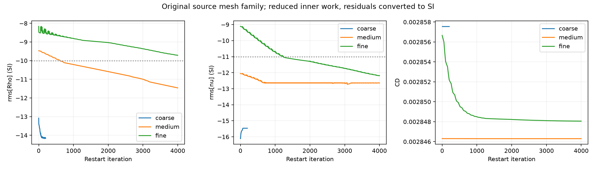
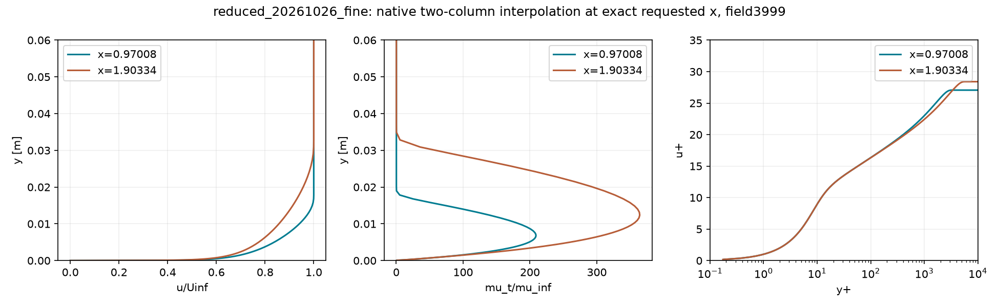
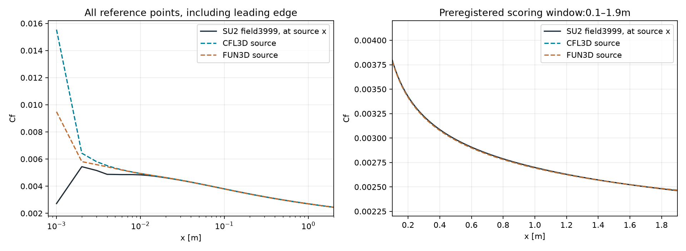

# Daha az iç çözüm işi ve üç ağda CFD denetimi

26 Ekim2026 · Dört yeni native SU2v8.5.0 koşusu · Kayıtlı2B sayısal şartların tamamı geçmedi; aile kabulü false. Genel fizik/M6/İHA kabulü **false**.

## Bulunan yöntem

İç doğrusal çözücü toleransı1e-6 yerine1e-3 kullanıldığında200 ortak adımın toplam akış+SA Krylov iterasyon sayısı **11144→6451** oldu: **%42.1123 azalma**. Bu sayı matris-vektör işlemlerinin veya duvar süresinin tam maliyeti değildir. Akış6500→3952, SA4644→2499.

Aynı ağ, aynı seed baytları, aynı fizik, dış çözüm yöntemi ve boyutsuzlaştırma korundu; eşli deneyde yalnız bu tek config satırı değişti. SI yoğunluk kalıntısı0.00143916log ve SA0.00121123log kötüleşti; ikisi de ön kayıtlı0,05log sınırı içinde. |ΔCD|=2.3e-11<1e-7. İş oranı0.57887653<0,7; kayıtlı maliyet hipotezi geçti. Önceki20,032s ve yeni10,563s gözlemi genel iki kat hızlanma kanıtı olarak kullanılmadı.

[SU2 doğrusal çözücü rehberi](https://su2code.github.io/docs_v7/Linear-Solvers-and-Preconditioners/) aşırı sıkı iç çözüm yerine toplam doğrusal olmayan ilerlemeyi izlemeyi önerir. Rehberden seçilen ayar bu vakada gerçekten sınandı; evrensel en iyi tolerans ilan edilmedi. Yalnız ölçekleme deneyinin önceki başarısız sonucu değişmedi.

## Aynı kaynak ailede gerçek devam çözümleri

NASA TMR düz plaka:3264/13056/52224hücre, M0,2, Re/m5e6, T300K; aynı geometri, dış sınır ve SA-neg fizik. ND FREESTREAM_VEL_EQ_MACH; Roe/MUSCL akış, birinci mertebe SA, FGMRES/LUSGS40, MG0 ve özgün adaptifCFL politikası korundu.1e-3 toleransla üç ayrı kaynak restartı fiziksel SI→ND dönüşümüyle kullanıldı. Bu devamlar soğuk başlangıçtan toplam maliyet kıyası değildir.

Kaba200/120s, orta4000/360s ve ince4000/900s sınırları çözümden önce sabitlendi. Ortak hamND artık−13 durdurucusunun eskiSI SA eşiğinden önce kesmemesi için CONV_STARTITER100000 önceden kaydedildi; fiziksel kabul eşiği değiştirilmedi. Sonuçlar aynı SI artık tanımında değerlendirilir. İnce rolü özgün ince checkpoint2000'den gelir; referansa daha yakın görünen tanısal aktarımlı seed seçilmedi.

| Ağ | Kayıtlı adım | Alan/son geçmiş | Süre,s | SI logρ | SI logν̃ | maxy+ | CD | İteratif şart |
|---|---|---|---|---|---|---|---|---|
| coarse | 200 | 199/199 | 2.5 | -14.1633770 | -15.4644348 | 0.951503 | 0.0028575623 | Geçti |
| medium | 4000 | 3999/3999 | 106.6 | -11.4615353 | -12.6484583 | 0.482212 | 0.0028462986 | Geçti |
| fine | 4000 | 3999/3999 | 697.7 | -9.7154332 | -12.1867190 | 0.258223 | 0.0028480591 | Geçmedi |

Alan/son geçmiş adımları eşleşmiyorsa son tam alanın kalıntısı kullanılır; daha sonraki CSV satırı alana atanmaz. Zaman aşımı veya eksik kayıtlı adım bütün aile kabulünü engeller. `solver.status.json` gerçek OS çıkışını ve kaynak sınırını korur.

| Önceden kayıtlı şart | Sonuç |
|---|---|
| Üç kayıtlı koşunun bütçe içinde tamamlanması | Geçti |
| Üç ağda SI kalıntıları ve son100 CD kararlılığı | Geçmedi |
| İnce ağ max y+ <1 | Geçti |
| Cf(x=0,97008 m), iki kodun en ince referansına fark <%2 | Geçti |
| Cf eğrisi iki kodla bağıl L2 <%3 | Geçti |
| İki istasyonda hız profili bağıl L2 <%3 | Geçti |
| İki kodla türbülans viskozitesi bağıl L2 <%5 | Geçti |
| Orta–ince Cf değişimi <%1 | Geçti |
| Orta–ince CD değişimi <%2 | Geçti |

Orta–ince Cf değişimi0.1664%; CD değişimi0.0619%. Bunlar tek başına ağ bağımsızlığı ya da hata bandı değildir. Global ön-kenar sürüklemesinin tekilliği ve asimptotik şartlar nedeniyle GCI/Richardson hata bandı **null** kaldı.

## İnce alanın kaynak kod kıyası

| Nicelik | Kaynak bölgesi | Nokta | Geçersiz | Kayıtlı pencere L2 | Tüm noktalarda L2 |
|---|---|---|---|---|---|
| Cf_curve | zone, t="CFL3D" | 447 | 0 | 0.2001% | 17.8439% |
| Cf_curve | zone, t="FUN3D" | 447 | 0 | 0.2338% | 9.6192% |
| velocity | zone,t="x=     0.97008" | 385 | 0 | 0.1202% | 0.1202% |
| velocity | zone,t="x=     1.90334" | 385 | 0 | 0.0882% | 0.0882% |
| eddy_viscosity | zone, t="CFL3D" | 384 | 0 | 0.6503% | 0.6503% |
| eddy_viscosity | zone, t="FUN3D" | 385 | 0 | 0.5898% | 0.5898% |

**Pencere ile tam eğriyi ayırmak gerekir:** Cf penceresinde farklar yaklaşık%0,20/%0,23 iken, başlangıç kenarı dahil bütün447 noktada L2 **%17,84/%9,62**. Özellikle x=0,001m noktasının native karşılığı kenar aralığında interpolasyondur ve kaynaklara belirgin uzak kalır. Bu noktalar çıkarılmadı; ön kayıtlı pencerenin geçmesini bütün plaka boyunca aynı doğruluk diye sunmuyoruz.

Cf eğrisinin önceden belirlenmiş0,1–1,9m penceresi ve pencere dışındaki bütün noktalar CSV'de tutulur. Hız istasyonları0,97008/1,90334m; iki native sütun arasında pozitif interpolasyon ve çift geçerlilik maskesi kullanıldı. Sıfır yer tutucular fiziksel örnek sayılmadı. Sütun uyuşma uzaklıkları ve geçersiz örnek sayıları JSON'da saklandı. Cf tek nokta kıyası hem aynı kaynak ağ sayısıyla hem her kodun en ince referansıyla ayrı verilir; ikisi karıştırılmaz.

İnce alan duvar Cf integrali CD=0.0028480591; native CD'ye bağıl fark0.0000%. Bu farklı ayrıklaştırma/integrasyonun kontrolüdür; yeni bir deneysel kuvvet değildir. Referanslar CFL3D/FUN3D sayısal çözümleridir; rüzgâr tüneli ölçümü değildir. Boyutlu Sutherland sabitlerinin bütün referans kodlarında tam özdeşliği ayrıca kurulmadı.

## Güvenilirlik ve sonraki ayrım

- Yeni mühürlerde215, ön-native kod arşivlerinde25, eski dondurulmuş kayıtlarda417 hash yeniden doğrulandı. GerçekİHA'nın3 girdi dosyası v0.12 ile aynı.
- Yeni maliyet kararı8/8, eksik referans/NaN/geçersiz prob/başarısız süreç gibi aile kararları12/12 kontrolü geçti. Bunlar yazılım kabul kontrolleridir; fizik veya LLM uzmanlığı kanıtı değildir.
- Son işlemde istasyonun grafik etiketi çıktı adını eziyordu. Etiketler ayrıldı; yeni grafik/JSON farklı koşu adlarını korur. Eski ham alanlar ve mühürler değiştirilmedi.
- Bu oturum referansları biliyor; kör LLM deneyi değil. Ajan promptu için yeni başarı iddiası veya hedef katsayı içeren ders eklenmedi.
- Bu reçete yalnız bu kaynak düz plaka ve koşul için sınandı. RAE2822, şok/ayrılma,3B M6, keyfiCAD→ağ, uçuşa elverişlilik ve genelCFD yeterliliği kapanmadı. Açık kapıyı yalnız iterasyon sayısı artırarak geçmiş saymayacağız.
- İnce koşunun son500 adımında akış iç çözümü%6,6 oranında40 iterasyon sınırına dayandı; son iç artık−2,0377, istenen log10(1e-3)=−3'e ulaşmadı. Bu bütün yavaşlığın sebebini kanıtlamaz. Rehberin iç çözüme yeterli iterasyon verilmesi önerisiyle, aynı son restartta yalnız40→80 tavanı için iki200-adımlık/180s kollu ayrı kontrol ön kaydedildi; **çalıştırılmadı**. Ortak yoğunluk kazancı≥0,3log, SA kötüleşmesi≤0,1log ve toplam Krylov işi oranı≤1,5 gerekecek. Otomatik tarama veya başarısız aileye ek adım yok. M6'ya doğrudan ayar taşımadan önce onun kendi kontrolü gerekir; bu turda yeniM6 koşusu yapılmadı.

[Makinece okunabilir tüm şartlar](../../uygulama/outputs/reports/reduced_family_review_20261026.json) · [Maliyet kıyası](../../uygulama/outputs/reports/flatplate_linear_work_20261026.json) · [Dosya/koşu denetimi](../../uygulama/outputs/reports/reduced_family_integrity_20261026.json) · [NASA kaynak vaka](https://tmbwg.github.io/turbmodels/flatplate_sa.html)

[Önceki kontrollü deneyler](../v0.12.0/README.md) · [Önceki kaynak M6 ve düz plaka](../v0.11.0/README.md)
