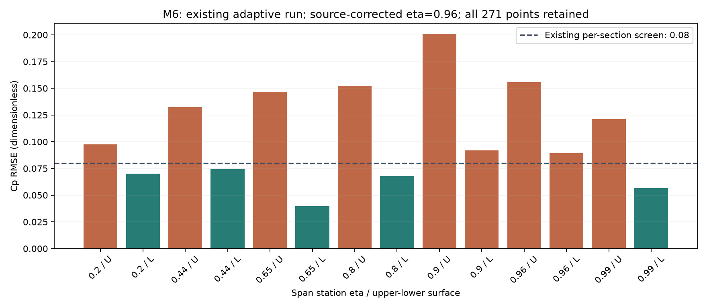

# CFD doğruluğu: hazır doğrulamalar, bizim farkımız ve uygulanabilir yöntemler

25 Ekim 2026 · ONERA M6 ve RAE2822 · kaynaklı araştırma ve mevcut kanıtların yeniden hesabı

**Sonuç:** Doğruluğu artırmak için somut yollar var; mevcut uyuşmazlığın kök nedeni henüz kanıtlanmadı. En yararlı sonraki adım, kaynak geometri–koşul–ağ–son işlem zincirinin birebir yeniden üretimidir. Daha fazla iterasyon, daha büyük ağ veya daha uzun ajan talimatı tek başına yeterli gerekçe değil. Genel M6/RAE fizik kabulü **false** kalıyor.

Bu turda yeni CFD çalıştırılmadı. Beş arXiv çalışması dahil 21 kaynak kaydı oluşturuldu; 20 dosya yerelde arşivlendi. LAVA sayfası web aracıyla okundu, doğrudan dosya indirmesi başarısız kaldı. Ağ üreticisinin küçük kaynak paketi indirildi ve incelendi; derlenmedi. Eski CFD alanları, kabul eşikleri ve değerlendirmeler değiştirilmedi.

[Yerel kıyasın sayısal kaydı](cfd_literatur_yerel_kiyas_20261025.json) · [Kaynak adresleri, durumları ve SHA256](../../work/cfd_literature_20261025/sources/manifest.json) · [Önceki dört gerçek M6 koşusu](guvenilirlik_gelistirme_20261025.html)

## 1. “Hazır test” hangi düzeyde hazırlanmış?

| Düzey | Gerçekte neyi gösterir? | Neyi göstermez? |
|---|---|---|
| Çözücü öğreticisi | Belirli dosyalarla ağ/çözücü/çıktı zincirinin çalışması | Deney hatası, ağ bağımsızlığı veya yeni CAD yeterliliği |
| Denklem ve yazılım doğrulaması | Aynı denklemlerin analitik/üretilmiş çözüm veya bağımsız kodla tutarlı çözülmesi | Türbülans modelinin gerçek akışı ne kadar iyi temsil ettiği |
| Çözüm doğrulaması | Aynı problemde iteratif, uzaysal, gerekiyorsa zamansal hata ve uzak sınır etkisi | Deneyle uyuşma veya farklı akış rejimine aktarım |
| Fiziksel doğrulama | Kaynak deney, koşullar ve belirsizlikle nicel karşılaştırma | Bütün uçaklar, stall, kararlılık veya uçuşa elverişlilik |
| Ajan değerlendirmesi | Dosya hazırlama, araç seçimi, hata teşhisi ve yanlış kabul davranışı | İlk dört katmanın kendiliğinden geçilmesi |

NASA'nın düz plaka kaynağı bu ayrımı açıkça yapıyor: aynı modelin farklı kodlarda ağ inceldikçe aynı sonuca yaklaşması bir uygulama kontrolüdür. Deneye uygunluk ayrı değerlendirilir. Sıkıştırılabilir ve sıkıştırılamaz çözümler düşük Mach'ta bile tam aynı referans değildir. [TMR düz plaka doğrulaması](https://tmbwg.github.io/turbmodels/flatplate.html)

**Bizim durumumuz:** dosya mühürleme, başarısızlığı saklama, bütün deney noktalarını koruma ve önceden belirlenmiş kapılar mevcut. Bunlar değerlendirmeyi denetlenebilir kılıyor. M6'da üç tutarlı ağ, tam bölgesel çözünürlük ve deney kabulü tamamlanmadığı için fiziksel yeterlilik sağlamıyor. Kendi denetçilerimizin de yanlış örneklerle sınanması gerekiyor.

## 2. Yayımlanmış M6 örneğiyle somut farkımız

| Başlık | SU2'nin 2014 M6 örneği | Bizim güncel M6 |
|---|---|---|
| Ağ büyüklüğü | 329.053 hücre, 96.252 düğüm | 258.969 hücre, 100.592 düğüm |
| Hücre dağılımı | Tetrahedron + prizma + piramit | 95.344 tetrahedron + 163.625 prizma |
| Fizik | Sıkıştırılabilir RANS; SA/SST karşılaştırması | RANS/SA; geçiş modeli yok |
| Uçuş koşulu | Mach 0,8395; alfa 3,06°; Re 11,72 milyon, 0,64607 m veter | Aynı nominal Mach/alfa/Re ve Reynolds referans uzunluğu |
| Sıcaklık | 273,15 K | 288,15 K, eski SU2 yapılandırmasından devralınmış |
| Sayısal yöntem | JST; türbülans birinci mertebe; düzeltilmiş viskoz gradyan | JST; türbülans birinci mertebe; v8.5 kaynak kodunda ana ağ iç gradyan düzeltmesi |
| Yakınsama sunumu | Yoğunluk artığında yaklaşık beş mertebe düşüş | Son alan log10 yoğunluk artığı −6,68701; görevdeki −7 kapısı açık |
| Deney kıyası | Dört açıklık kesitinde Cp grafikleri; kalan farklar tartışılıyor | Yedi kesit, 271 nokta; 14 üst/alt grubun mevcut ekranı ve tüm hata tablosu |

2014 makalesi bütün 271 nokta için bizimkiyle aynı RMSE'yi vermiyor. Grafikten “onlar yüzde şu kadar daha doğru” sonucu çıkarılamaz. Mutlak artık değeri ile başlangıca göre mertebe düşüşü de aynı ölçüt değildir. Kaynak, daha keskin şok çözünürlüğü için ağ iyileştirmesi gerektiğini ayrıca belirtiyor. [SU2 V&V, M6 bölümü](https://su2code.github.io/documents/SU2_AIAA_SciTech2014.pdf)

**Bizim çıkarımımız:** bu örnekte hesap boyutları benzer mertebede. Dolayısıyla ilk teşhis “bilgisayar yetmiyor, hücreyi milyonlara çıkaralım” olamaz. Aynı toplam sayıda düğümün duvar normalinde, şokta, uçta ve izde nasıl dağıtıldığı; geometri, operatör ve referans eşlemesi araştırılmalı. Düğüm merkezli ve hücre merkezli çözücülerin hücre sayıları da doğrudan eşdeğer işlem maliyeti değildir.

Sıcaklık farkı gerçek bir kurulum farkıdır; büyük Cp hatasının kanıtlanmış nedeni değildir. Mach ve Re sabitken sıcaklığa bağlı viskozite kanunu ve boyutsuzlaştırmanın tamamı değerlendirilmeden sıcaklıkla sonuç tutturulmaz.

## 3. M6 kaynaklarında kritik ayrıntılar

Güncel TMR vakası, özgün rüzgâr tüneli geometrisinin tam kopyası olarak tanımlanmıyor: sayısal karşılaştırma için keskin firar kenarlı geometri kullanıyor; deney kanadının firar kenarı sonlu kalınlıkta. TMR koşulu Mach 0,84, kök veterine göre Re 14,6 milyon, alfa 3,06° ve 300 K. Ayrıca altıncı deney kesitinin doğru konumunu **eta=0,96** olarak düzeltiyor. [TMR vaka tanımı](https://tmbwg.github.io/turbmodels/onerawingnumerics_val.html)

| Kontrol | Bu turdaki değerlendirme |
|---|---|
| Re 11,72 milyon mu, 14,6 milyon mu? | Tek başına sayı farkı hata değil. Bizde Re/L = 18.140.449,18 1/m; ölçülen 0,80600066 m kök veterinde Re yaklaşık 14,6212 milyon. Referans uzunluğunu birlikte okumak gerekiyor. |
| Yuvarlak uç nominal açıklığı aşıyor | Bizim kaynak yüzey yaklaşık 1,21809 m'ye uzanıyor. Nominal son profil kesiti 1,1963 m; TMR geometrisinde de yuvarlak uç uzantısı var. Bunu kendiliğinden bozuk geometri sayamayız. |
| Altıncı kesit | Eski ana değerlendirmede 0,95, ek değerlendirmede 0,96 vardı. Yeni kaynak, sonraki değerlendirme sürümünde 0,96 seçimini destekliyor. Eski sonuç korunuyor. |
| Birimler | TMR CAD biçimlerinin birimleri ve normalize ağ ölçeği aynı değil. Yeni kaynakta geometri/alan/veter/moment referansı yeniden kaydedilmeli. |
| Kaynak geometri eşdeğerliği | Eski ağ yüzeyi ile yeni keskin CAD birebir aynı sayılmıyor. Bunları aynı ağ yakınsaması ailesinde birleştirmemeliyiz. |

Geometri ayrıntıları için [TMR teknik tanımı](https://tmbwg.github.io/turbmodels/Onerawingnumerics_val/ONERA_M6_Test_Case_TMR.pdf) de okundu. Kaynaklı geometriyi yeniden tasarlamak yerine her temsilin uç biçimi, ölçüsü, ölçeği ve yüzey sapması ayrıca kaydedilmeli.

### Eski alanı yeniden çözmeden doğruladığım sonuç

Son sabit/adaptif CFL çiftinin 48 mühürlü dosya kaydı yeniden doğrulandı. Dört mevcut deney CSV'sindeki 271'er satırdan RMSE yeniden hesaplandı; kayıtlı sonuçlarla 1e−12 içinde eşleşti. Alan ve history iterasyonu her iki koşuda da 599. Kaynak kod veya dosya denetimi yeni akış çözümü değildir.

| Mevcut koşu | Eski ana kesit yorumu, eta6=0,95 | Kaynak düzeltmesiyle eta6=0,96 | Son yoğunluk artığı |
|---|---:|---:|---:|
| Sabit CFL | 0,12906125 | 0,12969596 | −6,65116445 |
| Adaptif CFL | 0,12906303 | 0,12969819 | −6,68700899 |

Cp RMSE **boyutsuz katsayı hatasıdır, yüzde hata değildir**. Kesit düzeltmesi büyük uyuşmazlığı gidermiyor. Son adaptif alanda max y+ yaklaşık **0,83224** ve bütün duvar noktaları 1'in altında; tam sınır tabakası, iz ve uç çözünürlüğü bundan çıkarılamaz. Kuvvet pencereleri geçse de artık ve deney kapıları açık.

Grafikteki 0,08 çizgisi mevcut vaka sözleşmesinin kesit ekranıdır. NASA'nın deneysel belirsizliğiyle veya tüm CFD için genel kabul eşiğiyle aynı şey değildir. Kaynak düzeltmeli yorumda da 14 grubun yalnız beşi bu ekranı geçiyor.

## 4. arXiv'de doğrudan işe yarayan sayısal çalışma

**Oliveira–Azevedo, “Numerical Aspects of Gradient Reconstruction Schemes Applied to Complex Geometries”, arXiv:2601.15522v1.** Hücre merkezli BRU3D çözücüsünde M6'nın 1,18/9,44/15,73 milyon hücreli ağlarını inceliyor. Basit arayüz gradyanı L00 kararsız; L0E/LJ0 düzeltmeleri kararlı ve birbirine yakın. Hücre içi gradyanlar bütün seçeneklerde Green–Gauss; asıl ayrım viskoz arayüz operatöründe. Cp yanında Cf ve bağımsız CFL3D karşılaştırması var; deney uyuşmazlıkları tamamen bitmiyor. Önerilen yüksek CFL stratejisi Jacobian, doğrusal çözüm ve fizik dışı güncelleme reddiyle birlikte çalışıyor. [Tam makale](https://arxiv.org/abs/2601.15522)

**Bize uygulanması:** kurulu yöntem adını görmek yeterli değil; ayrık operatörün hangi düzeltmeyi uyguladığını incelemeliyiz. “Green–Gauss kullanıyoruz, o halde L00 hatasına düştük” teşhisi desteklenmiyor. Yerelde arşivlediğim SU2 v8.5 sürümünde `CDriver.cpp:1804`, ana ağdaki ideal gaz iç viskoz akısını düzeltme etkin olarak kuruyor; `flow_diffusion.cpp` bu düzeltmeyi çağırıyor. Bu kaynak incelemesidir; kurulu ikili programın dalı ayrıca çalışma anında ölçülmedi. [Sürüm etiketli sürücü](https://raw.githubusercontent.com/su2code/SU2/v8.5.0/SU2_CFD/src/drivers/CDriver.cpp), [viskoz operatör](https://raw.githubusercontent.com/su2code/SU2/v8.5.0/SU2_CFD/src/numerics/flow/flow_diffusion.cpp)

Bizim önceki CFL_ADAPT denemesi de makaledeki algoritmanın yeniden üretimi değil. Bu iki sonucu eşitleyip yaklaşımın işe yaramadığı sonucuna varamayız. Kaynak Jacobian ve güncelleme korumalarını kurmadan yalnız CFL üst sınırını büyütmek gerekçelendirilmiş bir uyarlama olmaz.

## 5. Hazır bir ağ üreticisi: somut olarak ne buldum?

TMR, Fortran ağ üreticisi ve aynı aileyi kabalaştıran programı yayımlıyor. SU2 dosyası yazma anahtarı var. İkinci girdi ailesi daha fazla yüzey noktası ve daha düşük hücum/firar kenarı gerilmesi kullanıyor. Bu, düzenli üç ağ ailesi kurmak için yeni bir genel ağlayıcı yazmaktan daha somut bir başlangıç. [Resmî ağ sayfası](https://tmbwg.github.io/turbmodels/onerawingnumerics_grids.html)

125.194 baytlık paketi indirdim; iki Fortran kaynağını, README'yi ve kesit dosyasını inceledim. **Kurulmuş/derlenmiş veya ağ üretmiş değil.** PATH üzerinde gfortran/ifort/g95 bulunmadı; bu bütün diskte derleyici yok demek değil. Sağlanan girdide SU2 yazma varsayılanı kapalı; açılması gerekiyor. Örnek büyük ağ girdisini bütçe hesabı yapmadan çalıştırmayacağız. Kaynak dosyalar [inceleme klasöründe](../../work/cfd_literature_20261025/generator_inspection/readme_release.txt).

Önemli sınır: bu üreteç normalize kök veteri ve keskin firar kenarı tanımıyla **yeni bir kaynak vakası** olur. Eski M6 ağlarımızın üçüncü seviyesi sayılamaz. Önce düşük maliyetli bir seviyede ölçek, sınır etiketleri, hücre yönelimi, hacimler, yüzey ve kanat kesitleri sınanmalı; sonra aynı kaynak tanımıyla aile kurulmalı.

## 6. Daha önce deneyenlerin yararlı tecrübeleri

**NASA LAVA M6 öğreticisi:** ağ, çözücü girdisi, yedi Cp kesiti çıkarma dosyası, deney verisi ve HPC çalıştırma örneği sağlıyor. Limitörlerle artıkların yaklaşık 500 iterasyonda plato yapabildiğini belirtiyor; kuvvet izlemesini de öneriyor. Bu, her plato kabul edilebilir demek değil; bizim kayıtlı −7 kapısını gevşetmiyor. Öğretici tek başına üç ağlı belirsizlik çalışması değil. [LAVA M6](https://nas.nasa.gov/LAVA/unst_docs/tutorials/onera_M6/onera_M6/)

**Balan ve diğerleri, 2020, M6 anizotropik uyarlama:** dört çözücü, farklı metrik uygulamaları ve yeniden ağlayıcılarla karşılaştırma yapılıyor. Mach alanı Hessian'ını hesaplamak sadece bir bileşen; metriğe uygun yeni ağ, geometri koruma, alan aktarımı ve yeniden yakınsama döngüsü de gerekiyor. İnce referans çok büyük olsa da uyarlama çalışmaları farklı karmaşıklık bütçelerinde yürütülüyor. Bizim maskeli yerel Hessian göstergesi bu zincirin tamamını yeniden üretmiyor. [NASA arşivindeki çalışma](https://ntrs.nasa.gov/citations/20200003084)

**DLR, AMR25, 2025:** CAD'e yeni yüzey düğümü yansıtılırken çok ince duvar katmanlarında hacim ağının bozulması ele alınıyor. Sunumdaki M6 prototipi ikinci uyarlamadan sonra başarısız; 2D'de çalışan yaklaşım 3D'de yetmemiş. Katman sütunlarını korumak, kademeli/nonlineer deformasyon ve sütun boyunca koordinat aktarımı tartışılıyor; sunumdaki önerilerin tamamı denenmiş çözüm değil. Bu bütün DLR yazılımının başarısızlığı değil, raporlanan prototipin sınırı. [Sunum, M6 sonuçları ve sonraki adımlar](https://elib.dlr.de/216488/1/AMR25_AlgoGeoAdaptedMeshRef_2025-09-02_pub.pdf)

**Bizim çıkarımımız:** büyük basınç/Mach gradyanı gösteren yere otomatik küçük hücre koymak yeterli değil. İnceleme göstergesi → destekli metrik → CAD ve katmanları koruyan ağ → alan aktarımı → yeniden çözüm → yeni kanıt döngüsünün her halkası sınanmalı. Bugün ilk halkada sınırlı prototipimiz var.

## 7. CFD ajanlarını gerçekten kuranlar ne başarmış?

Bu bölümdeki çalışmalar arXiv ön baskılarıdır. Bildirdikleri sonuçları burada yeniden üretmedim; başarı tanımlarını aynı kabul ölçütüymüş gibi karşılaştırmadım.

| Çalışma | Yapılan sınama ve sonuç | Bizim için ders / sınır |
|---|---|---|
| **Foam-Agent**, 2509.18178v1, 2025 | 110 görevde Claude 3.5 Sonnet ile %88,2 bildirilen çalıştırma başarısı; bilgi getirme, dosya bağımlılıkları, inceleme/düzeltme ve MCP araçları | Kaynak örnekleri ve tutarlı dosya üretimi yararlı. Bu oran rüzgâr tüneliyle doğruluk veya bütün görevlerde ağ bağımsızlığı oranı değil. |
| **A Preliminary Assessment of Coding Agents for CFD Workflows**, 2602.11689v1, 2026 | Öğretici temelli dosya kullanımı, az değişiklik ve loga göre onarım; öğretici türevleri ve seçilmiş 2D engel geometrileri | Genel kod ajanı da kullanılabiliyor; geometri/ağ oluşturma daha zor. Başarıda hedef zamana ulaşma esas. GPT-5.2'nin bir ağ denemesinde ek insan yönlendirmesi var; tam eşit otonomi kıyası değil. |
| **CFD Forge**, 2610.14104v1, Ekim 2026 | 13 görünür yerleştirilmiş hatanın 12'sini model tek başına üç tekrarda da kabul etmiş; deterministik kapılar yanlış kabulü engellemiş | Kabulü LLM kararından ayırmak doğrudan yararlı. Sabit kural aynı hükümleri veriyor; istemler de farklı. Kapsam nozzle/step ağırlıklı; tam M6 deney/yakınsama yeterliliği gösterilmiş değil. |
| **AI CFD Scientist**, 2605.06607v1, 2026 | Beş görev; bir periyodik tepe vakasında 44 iterasyonla DNS'ye göre alt duvar Cf RMSE'sinde %7,89 azalma; görsel kontrol 16 hatanın 14'ünü yakalamış | Görsel inceleme ek kontrol olabilir, tek kabul mercii olamaz. Bildirilen ağ ekranı iki seviyeli; üç ağ asimptotik belirsizlikle aynı değil. Başka geometriye aktarım sınanmamış. |

Kaynaklar: [Foam-Agent](https://arxiv.org/abs/2509.18178), [kod ajanları değerlendirmesi](https://arxiv.org/abs/2602.11689), [CFD Forge](https://arxiv.org/abs/2610.14104), [AI CFD Scientist](https://arxiv.org/abs/2605.06607).

Son çalışmadaki DNS'ye bakarak türbülans modeline kaynak terimi eklemek, model geliştirme araştırmasıdır. Bizim sabit modelle bağımsız M6 doğrulaması hedefimizde aynı deney verisine uyacak terim/katsayı eklemek ayrı bir kalibrasyon olur; kabul başarısı diye sunulamaz. Yeni koşul/geometri üzerinde saklı değerlendirme gerekir.

Bu yayınlar yaptığımız işin mümkün olduğuna dair örnekler sunuyor; mevcut sistemimizin genel CFD doğruluğunu kanıtlamıyor. Bizdeki sözleşme, mühür ve yanlış kabul kontrolleriyle benzer fikirler var. Bu mimarinin bize özgü bilimsel yenilik olduğunu iddia etmiyorum.

## 8. RAE2822 için fark ne?

NASA'nın hazır RAE çalışmalarında ağ, fizik koşulları ve son işlem tarifleri mevcut. Tünel düzeltmeli koşul ile nominal deney koşulunu ayırmak gerekiyor. Referans sayısal kuvvet listesini deneysel kuvvet diye kullanamayız. [NASA Study 1](https://www.grc.nasa.gov/www/wind/valid/raetaf/raetaf01/raetaf01.html), [Study 4](https://www.grc.nasa.gov/www/wind/valid/raetaf/raetaf04/raetaf04.html)

Yerelde aynı C1 temsil/200c sınır üzerinde 26.112/57.505/128.726 hücreli aile var. Orta→ince CL farkı %0,2138, CD farkı %1,4119; dar sayısal ekran geçti. Fakat ayrı 0,01c→0,02c duvar-normal katman deneyinde CL/CD yaklaşık %3,98/%4,68 değişti. Normal doğrultudaki çözünürlük etkisi açıkken küçük ana aile farkı yeterli değil. 400c ağı çözülmedi; uzak alan duyarlılığı bilinmiyor. Kaynak deneyin 103 noktasında ince ağ Cp RMSE 0,06703 ile 0,03 kapısını geçmedi. [Dondurulmuş RAE değerlendirmesi](../projects/proje-15cce2de02/reports/review_v2_qualification.json)

**Bizim çıkarımımız:** önce kontrollü sınır tabakası/TE/iz geçişi ve kaynak temsilini sabitlemek gerekiyor. Başka türbülans modelinin daha iyi sonuç vermesi mümkün bir hipotez; önce mevcut modelin ağ ve yakınsama etkisini ayırmadan kök neden ilan edilemez. Deney trip/transition bilgisiyle tam türbülanslı hesabın kapsam farkı da açık kalmalı.

## 9. Bundan sonra uygulanacak yöntem: önce hangi hatayı ayıracağız?

Aşağıdaki sıra bu araştırmadan çıkardığım öneridir; yeni deneyler henüz çalışılmadı. Mevcut fiziksel kabul eşikleri korunuyor. Her yeni kaynak vakasının sözleşmesi çözümden önce kendi geometri/koşul/kapsamına göre hazırlanmalı.

| Öncelik | İş ve amacı | Başarı nasıl anlaşılacak? | Maliyet / durum |
|---|---|---|---|
| 1 | **Kaynak vakayı birebir yeniden üretme.** Tek bir yayımlanmış geometri, aynı ağ ve şartnameyi dondur; kaynak sürümü/SA varyantı, serbest akım türbülansı, birimler ve sınırları açıklaştır. | Kaynakla fark tablosu boş veya gerekçeli; solver ve son işlem aynı noktaları/alanları karşılaştırıyor. Kaynak sürüm elde edilemezse “birebir” denmeyecek. | En yüksek teşhis değeri; dev ağ gerektirmez. Henüz koşulmadı. |
| 2 | **Son işlemi bağımsız çapraz kontrol.** eta6=0,96 için yeni değerlendirme sürümü; kesit LE/TE ve x/c eşlemesini kaynak koordinatlarıyla denetle; ikinci kesme/enterpolasyon ve kuvvet integrasyonu. | Bütün noktalar korunur; iki algoritmanın farkı konumsal verilir. Şok/kenar noktaları hata düşürmek için çıkarılmaz. | Mevcut alanla düşük maliyet; bu tur yalnız var olan iki CSV yorumu yeniden hesaplandı. |
| 3 | **Küçük model/operatör kontrolü.** TMR SA düz plaka; gerekirse üretilmiş çözümle kurulu ayrık yöntemin hata mertebesi. | Cf, hız ve türbülans profilleri aynı model/BC'li kaynak çözüme ağ inceldikçe yaklaşır. | M6'dan ucuz. Yeni vaka ve kaynak ağ dönüşümü gerekiyor; yapılmadı. |
| 4 | **M6 artığını denklem ve konuma göre ayır.** Duvar/TE/uç/uzak alan katkısını tutarlı aynı iterasyonda incele; limitör/dissipasyon veya Jacobian mekanizması için tek değişkenli kontrol seç. | Önerilen neden yalnız ipucuyla değil, kontrollü etki ve kuvvet/Cp değişimiyle desteklenir. VTU çalışma vektörü history RMS yerine kullanılmaz. | Mevcut alanla teşhis + sınırlı native çift. Yeni çözüm bu tur yok. |
| 5 | **Kaynak üreteciyle sistematik aile.** Aynı geometri/dış sınır/koşulda en az üç seviye; duvar normal, LE/TE, uç ve iz oranlarını birlikte kaydet. Ayrı uzak alan çifti kur. | Bütün seviyeler iteratif kabulü geçer; normal profiller ve bölgesel çözünürlük yeterli olur. Asimptotik/monoton davranış yoksa GCI güvenilir hata bandı verilmez. | Kademeli bütçe gerekir; örnek en büyük ağ girdisi doğrudan çalıştırılmayacak. |
| 6 | **Hedefe yönelik tam ağ uyarlaması.** Alan Hessian'ı veya CL/CD adjoint metriği; geometri ve katman koruma, yeni ağ, aktarım ve tekrar çözüm. | Her uyarlamada pozitif hücreler, yüzey sapması, katman desteği ve hedef niceliğin kontrollü değişimi gösterilir. | Daha fazla geliştirme; tam remesher/adjoint şu an yok. |
| 7 | **Bağımsız fizik kabulü ve ajanın yeni vakada sınanması.** Kaynak kod kıyası + deney + uygun belirsizlik; ardından hedefleri görmeyen yeni görevler. | Sayısal, deneysel ve davranışsal kapılar ayrı geçer; açık kapı varken otomatik tasarım seçilmez. | Önceki kapılara bağlı; genel yeterlilik henüz kanıtlanmadı. |

NASA'nın ağ yakınsaması rehberi, yalnız hücre sayısı değil duvar-normal/sınır/birleşim aralıklarının oranlarını da korumayı öneriyor. Richardson/GCI değerlendirmesi, yeterli yakınsama ve uygun ağ ailesi gerektiriyor; şok çevresinde yerel davranış ayrıca ele alınmalı. [NASA uzaysal yakınsama rehberi](https://www.grc.nasa.gov/www/wind/valid/tutorial/spatconv.html)

## 10. Hangi öneriyi şimdilik uygulamayacağız?

- Aynı CFL veya doğrusal iterasyon sınırının daha çok değerini gerekçesiz taramak: önceki kontrollü çiftler kayıtlı etki ölçütünü geçmedi.
- Deneye uyana kadar alfa/Mach/Re/sıcaklık, türbülans katsayısı veya kabul eşiğini değiştirmek: bağımsız doğrulamayı kalibrasyona dönüştürür.
- Her bölgeyi aynı oranda büyütmek: problemli normal/teğetsel yöndeki yetersizliği ve geometri farkını gizleyebilir.
- Tam RANS ağı yerine yalnız ilk y+ değerini kabul etmek: dış katman geçişi, uç ve iz açık kalır.
- Başarılı OpenFOAM ajan paketini kurmanın mevcut M6 hatasını kendiliğinden çözeceğini varsaymak: çözücü ve altyapı değişirken aynı fizik/mesh/QoI kıyası ayrıca gerekir.

**Karar:** ajanı daha çok konuşturmaktan önce, kaynak vakanın birebir tekrarını ve bağımsız son işlem denetimini tamamlamak en iyi gerekçelendirilmiş sonraki iş. Sonra küçük SA kontrolü ve tutarlı ağ ailesiyle hata kaynaklarını ayıracağız. Bu sıra bir araştırma önerisi; doğruluk artışı gerçekleşmiş gibi raporlanmıyor.

## Kanıt ve erişim notları

- [Yerel kanıt ve sürüm kaydı](cfd_literatur_yerel_kiyas_20261025.json)
- [Kaynak arşivi manifesti](../../work/cfd_literature_20261025/sources/manifest.json): URL, sürüm/okuma kapsamı, UTC, bayt ve SHA256; başarısız LAVA arşiv indirimi görünür.
- [Araştırma sırasında yaşanan erişim/okuma sorunları](../../work/cfd_literature_20261025/research_log.md): CFD koşuları etkilenmedi.
- [Görev kaydı](../data/tasks/20261025-005212-dd782d.json): bu araştırmanın tamamlanması, genel CFD yeterliliğinin tamamlanması değildir.

Kaynak taraması bütün literatürü tükettiği iddiası taşımaz. Öncelik, mevcut RAE/M6 sorunu ve kurulabilir yöntemlerdi. İkinci el özetler yerine resmî vaka sayfaları, sürüm etiketli kaynak kod, makale metinleri ve yazar sunumu kullanıldı. Maliyetler ölçülmüş süre tahmini değil, göreli iş kapsamıdır.
