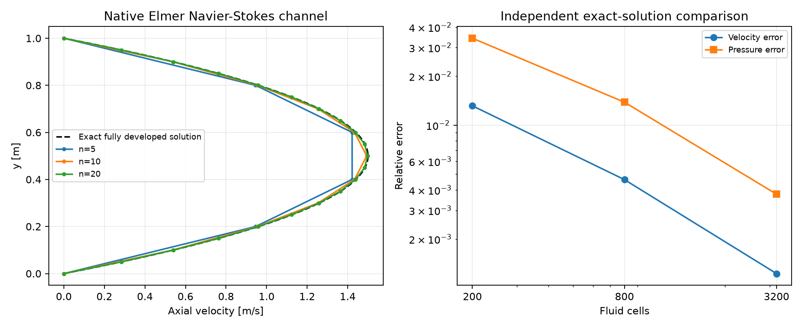
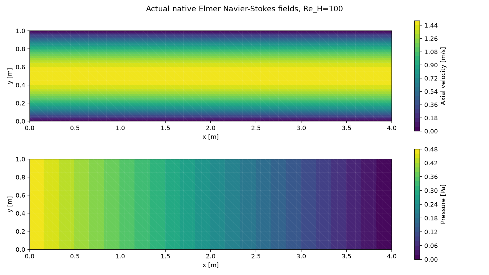
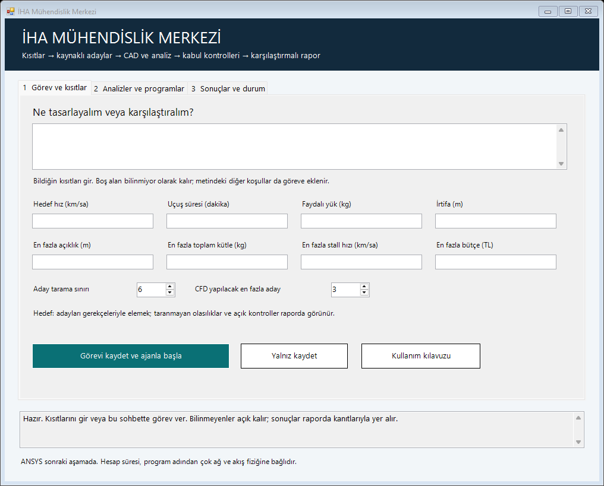

# Hafif CFD araçları ve kısıtlardan karşılaştırma raporuna iş akışı

18 Ekim 2026 · Yerel kurulum, gerçek çözücü testi ve arayüz güncellemesi

**SU2'nin yanına taşınabilir Elmer CFD ve ElmerGUI eklendi. Basit arayüz artık görev/kısıt girişi, analizler ve sonuçlar sekmelerinden oluşuyor. Araştırma → aday CAD → ön analiz → CFD → eleme/sıralama → rapor için birimli, kanıt isteyen görev kaydı oluşturuyor. Herhangi bir uçak geometrisini bütünüyle doğrulanmış biçimde otomatik değerlendirme seviyesine henüz ulaşılmadı.**

[Mühendislik Merkezi](../Muhendislik-Merkezi.cmd) · [bütün proje durumu](../Proje-Ozeti.html) · [önceki CAD/VLM/SU2 yeterlilik raporu](muhendislik_seviyesi_ve_cfd.html)

## 1. ANSYS öncesi hangi CFD araçları var?

| Araç | Kurulum / görev | Gerçekte doğrulanan kapsam |
|---|---|---|
| SU2 v8.5.0 | Önceden kurulu; resmi paket yaklaşık 28 MB | Euler ve üç ağda 2D viskoz RANS; basınç, sürtünme, y+ ve kuvvet geçmişi |
| Elmer 26.2 | Bu tur kuruldu; taşınabilir GUI/çözücü paketi 219.035.726 bayt | Gerçek sıkıştırılamaz Navier–Stokes, üç ağda laminer kanal; analitik çözüm ve debi dengesi |
| Gmsh | Önceden kurulu; ağ ve alan görüntüleme | SU2/Elmer basınç alanlarının native okunabilen .pos görünümü |
| OpenFOAM | Araştırıldı; kurulmadı | Bu bilgisayarda WSL kurulu değil; alternatif Windows dağıtımı daha büyük |
| ANSYS | Ertelendi | Kurulum ve lisans doğrulaması yapılmadı |

SU2 ve Elmer gerçek akış denklemlerini ağ üzerinde çözer. Elmer, sonlu eleman tabanlı çok fizik çözücüsüdür; CFD için Navier–Stokes modülü kullanıldı. [CSC'nin Elmer açıklaması](https://docs.csc.fi/apps/elmer/), [resmi taşınabilir Windows paketleri](https://sourceforge.net/projects/elmerfem/files/WindowsBinaries/Win64Installer/).

OpenFOAM'ın resmi Windows yolu WSL gerektiriyor. blueCFD'nin OpenFOAM 12/ParaView/MSYS2 içeren Windows kurucusu 1173 MiB olarak listeleniyor. Hafif kurulum isteğine uygun olarak şu aşamada SU2 + Elmer seçildi; WSL veya sistem ayarı kurulup değiştirilmedi. [OpenFOAM Windows tarifi](https://openfoam.org/download/windows/), [blueCFD paket bilgisi](https://bluecfd.github.io/Core/Downloads/).

Elmer arşivi resmi CSC/Funet sunucusundan HTTPS ile alındı; ZIP CRC ve yerel SHA256 kaydedildi. Listede upstream SHA256 bulunmadığından bağımsız upstream hash eşleşmesi iddia edilmiyor. Native log gerçek sürümü **26.2-unknown, Rev: Release, derleme 2026-08-05** olarak bildirdi. Proje içi kurulum, süreç ortam değişkenleri ve tam dosya yolları kullanılıyor; global PATH değiştirilmedi.

“Hafif” burada kurulum yükünü anlatıyor. Büyük bir üç boyutlu türbülanslı model, bu araçlarda da uzun sürebilir; ağ, yakınsama ve akış fiziği hesap maliyetini belirler.

## 2. Yeni gerçek CFD testi

ElmerGrid ile Gmsh ağı Elmer'e çevrildi; ElmerSolver gerçek Navier–Stokes denklemlerini çözdü. Referans, tam gelişmiş düzlem Poiseuille akışının analitik çözümü. Test girdileri **varsayım**, native sonuçlar **sayısal ölçüm** olarak sınıflıdır; gerçek İHA şartları değildir.

Koşullar: kanal L=4 m, H=1 m; rho=1 kg/m³, mu=0,01 Pa·s, ortalama hız=1 m/s, Re(H)=100. Giriş parabolik hız, duvar kaymaz, çıkış basıncı sıfır. Beklenen alanlar: u=6y(1−y), v=0 ve p=0,12(4−x), SI birimleriyle.

| Akış hücresi | Hız alanı bağıl L2 hatası | Basınç alanı bağıl L2 hatası | Giriş–çıkış debi farkı |
|---|---|---|---|
| 200 | %1,315 | %3,419 | %0,842 |
| 800 | %0,463 | %1,384 | %0,273 |
| 3200 | %0,123 | %0,376 | %0,080 |

Üç ağda doğrusal olmayan çözüm değişimi 10⁻⁹'un altına indi. Ağ inceldikçe hız/basınç hataları azaldı. İnce ağ, belirlenen hız <%2, basınç <%5 ve debi dengesizliği <%0,2 ölçütlerini geçti. İlk alan-adlandırma hatalı deneme reddedildi, düzeltme yeni çalıştırmada doğrulandı; ham kayıtlar korundu.

[Elmer ölçümleri ve ham dosya yolları](elmer_cfd_qualification.json). İnce alanın basıncı Gmsh biçimine çevrildi ve 3200 üçgenle tekrar okundu. Bu test çözücü/birim/sınır şartı bağlantısını bilinen bir fizik çözümüyle kontrol eder; Elmer'de dış aerodinamik, türbülans, geçiş veya üç boyutlu uçak yeterliliği kazandırmaz.

Önceki SU2 RANS çalışmasının sürükleme ağ kabulü hâlâ açık: orta→ince ağ CD farkı %22,84, max y+=1,744. Elmer'deki geçen kanal testi bu açığı kapatmış sayılmadı. [SU2 kabul kontrolleri](cfd_reference_comparison.json).

## 3. Arayüz nasıl çalışıyor?

İlk sekmede görev ve bilinen kısıtlar girilir: hedef hız, süre, faydalı yük, irtifa, maksimum açıklık/kütle/stall hızı ve bütçe. Boş alanlar bilinmiyor kalır. Açık sıfır ile boş girdi ayrılır; km/sa → m/s ve dakika → saniye dönüşümleri kayda alınır. Özgün değerler ve kullanıcı kaynağı da korunur. Diğer geometrik, üretim veya kullanım koşulları görev metnine yazılabilir.

**Görevi kaydet ve ajanla başla**, yapılandırılmış girdiyi ve yedi adımlı kabul sözleşmesini görev dosyasına yazar, sonra mevcut yerel Codex başlatıcısını açar. Her adım bekliyor/çalışıyor/tamamlandı/uygulanmıyor/engelli olarak izlenir. Tamamlanan adımda kanıt, uygulanmayan adımda gerekçe gerekir. **Yalnız kaydet** ajan oturumu başlatmadan kaydeder.

İkinci sekmede araç sınamaları ve uygulama/alan açma düğmeleri bulunur. Bu düğmeler kayıtlı yeterlilik örneklerini tekrarlar; serbest kullanıcı tasarımını hazır örneğe dönüştürmez. Üçüncü sekme raporları ve görev/girdi klasörlerini açar.

Arayüz aynı dosya ve komut girişlerinin üstündedir. Ajanın bu pencereyi kullanması gerekmiyor; bu sohbetten de bütün araçlara erişilebilir. Kullanım için yeni bir mühendislik modeli eğitilmedi. Yeni bir LLM oturumu test amacıyla otomatik başlatılmadı; görev aktarımının dosya ve başlatma hazırlığı kontrol edildi.

## 4. İstediğin uçtan uca aşamaya ulaştık mı?

**Kısmen. Araştırma ve araçlarla yürütülen görev akışının parçaları var; bütün geometri ve akış rejimlerine genellenmiş, doğrulanmış bir otomatik tasarım sistemi henüz yok.**

| Adım | Hazır taraf | Açık taraf |
|---|---|---|
| Kısıtları almak | Form/sohbet, SI birimleri, kaynak ve görev kaydı | Göreve özgü eksik kritik girdiler tamamlanmalı |
| İnternetten aday araştırmak | Ajan bu oturumdaki web araçlarını kullanabilir; kaynak/tarama sözleşmesi görevde | Arayüzün kendi başına sınırsız araştırma yapan ayrı bir motoru yok |
| CAD çizmek | Tanımlı kanat/nervür ailesi ölçü kontrolüyle çalışıyor; OpenVSP/FreeCAD bağlantıları var | Yeni geometri aileleri ayrıca geliştirilip sınanmalı; Fusion motor testi açık |
| Ön analiz yapmak | Gerçek XFOIL/VSPAERO ve yapısal çözücü bağlantıları | Tüm uçak güç/enerji/trim/kararlılık ve yük modeli tamamlanmadı |
| CFD yapmak | Native SU2 Euler/RANS ve Elmer Navier–Stokes çalışıyor | Keyfi CAD için uygun hacim/sınır-tabakası ağı; CAD/analiz eşdeğerliği ve sürükleme kabulü |
| Eleme ve sıralama | Açık kısıtlar, koşullu sıra, başarısız/eksik CFD'yi kullanmama kontrolleri | Nihai sıra için her adayın kendi kapsamına uygun kabul edilmiş kanıtı gerekiyor |
| Rapor vermek | CAD, alanlar, grafikler, kaynaklar ve açık kontroller birlikte sunuluyor | Bilinmeyen girdilere bağlı fiziksel uygunluk kararı verilemiyor |

“Olabilecek tüm ihtimaller” yerine **tanımlı tasarım alanı, aday bütçesi ve kapsama kaydı** gerekiyor. Her görevde araştırılan profil/yerleşim/ölçü aileleri, elenme sebepleri ve taranmayan seçenekler belirtilmeli. Sonlu bir aramadan bütün mümkün tasarımların tüketildiği sonucu çıkarılamaz.

## 5. Sıralama nasıl sınandı?

Önceden çözülen üç dikdörtgen kanat, yeni eleme/sıralama koduna verildi. Bu tur o kanatlar yeniden çözülmedi. Test varsayımı maksimum açıklık=2,1 m: AR10 sınırı aştığı için elendi. Kalanlarda tahmini izole kanat sürüklemesine göre koşullu sıra AR8 → AR6 çıktı.

**Nihai kazanan verilmedi.** Bu adayların kendi geometri/koşullarıyla kabul edilmiş CFD'si yok; 2D başka bir profil çözümü onların 3D kanat CFD'si sayılamaz. Sonuç dosyasının hash'i, geometri özeti, koşul özeti ve analiz kapsamı uyuşmadan CFD kabulü aktarılamıyor. Gerçek uçak kütle/güç/kararlılık/yapı kontrolleri de ayrı açık.

[Koşullu karşılaştırma tablosu](candidate_comparison.html) · [kanıt ve gerekçeler](candidate_comparison.json) · [17 girdi/aktarımı/sıralama kontrolü](workflow_checks.json).

Kontroller, eksik CFD'nin nihai kazanan üretmemesini, değişmiş/ilgisiz kanıtın reddini, sert kısıta uymayan düşük-sürüklemeli adayın elenmesini ve bilinmeyen metriğin sıralanmamasını kapsıyor. Bu testler fiziksel tasarım güvencesi değildir.

## 6. Sonraki gerçek görev

Gerçek kısıtlarını ilk sekmeye veya bu sohbete ver. İlk somut çıktı; gereksinim/eksik veri tablosu, kaynaklı ve sınırlı aday kümesi, hangi adayda hangi CAD/ön analiz/CFD kontrolünün yapılacağı ve karşılaştırma ölçütü olmalı. Sonra araçlar o geometri ve şartlar için çalıştırılır; başarısız kabul ve veri eksikliği raporda açık kalır.

Mevcut gerçek İHA görev ve kütle dosyaları bu kurulumda doldurulmadı; kavramsal sekiz adım bekliyor. Araçların geçmesi tasarımın tamamlandığı, uçuşa elverişlilik veya halüsinasyonsuzluk anlamına gelmez.
