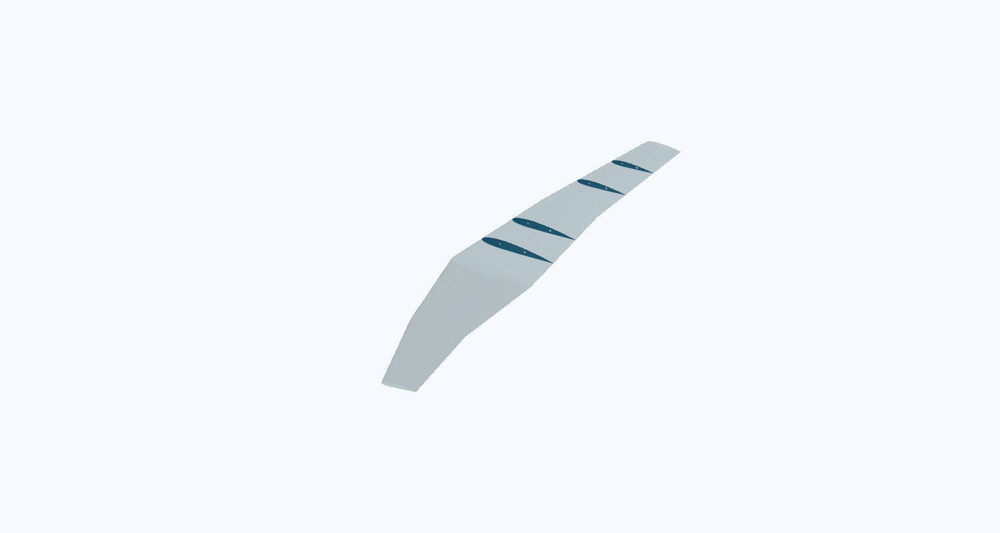
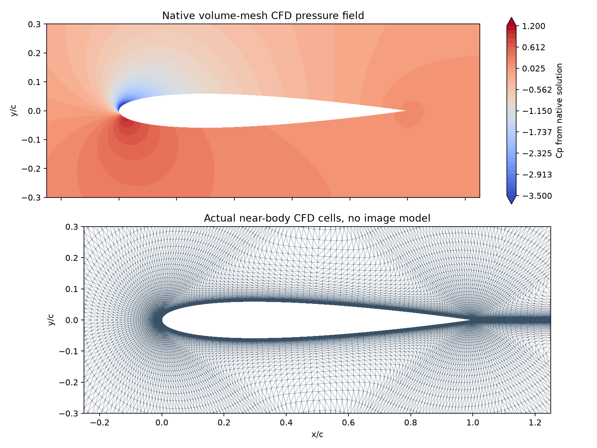
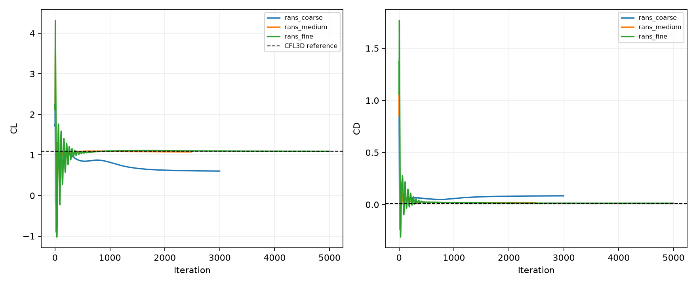

# Deterministik CAD, gerçek aerodinamik ve CFD: yapılanlar ve kabul sınırları

18 Ekim 2026 · Üniversite projesinde kullanılacak araç zincirinin yeterlilik çalışması

**Bu turda ölçülerden tekrar üretilebilen bir kanat/nervür CAD programı, karmaşık kanat için gerçek VSPAERO çalışması ve hacim ağı üzerinde çalışan SU2 CFD eklendi. CAD kontrolleri geçti. CFD ve VLM sürükleme kontrollerinin tamamı geçmedi; sonuçlar koşullu ve açık kabul durumuyla saklandı. Autodesk girişi başarılı, Fusion motorundaki modelleme testi bağlantı yenilemesini bekliyor.**

Bu rapordaki kanat boyutları araç sınaması için seçilmiş varsayımlardır. NACA2412 koordinatları kaynaklıdır. SU2 test koşulları resmi örnekten alınmıştır. Çözücüden okunan sayılar yerel yazılım ölçümüdür; fiziksel deney değildir. Gerçek İHA gereksinimleri ve kütleleri bu çalışmada doldurulmadı. [Girdi sınıflandırması ve hash kaydı](engineering_extension_evidence.json).

## 1. Çizimi kim yapıyor, mekanik çalışan sistem ne demek?

Şimdiye kadar çizim programlarını ve araç bağlantılarını ben, Codex, yazdım. Yeni kanat üretiminde küçük CAD modeli kullanılmıyor. Kayıtlı program; kaynak profil koordinatlarını, kanat istasyonlarını, birimleri, burulmayı, nervür ve delik tanımlarını alıp CadQuery/Open CASCADE çekirdeğinde geometri oluşturuyor. CAD çekirdeği kesme, birleştirme ve dışa aktarmayı gerçekleştiriyor. Aynı tanım yeniden çalıştırılabiliyor; çıktı ölçü ve topoloji kontrollerinden geçiriliyor.

Bu, istediğin mekanik yaklaşıma karşılık geliyor: **açık girdi → sabit geometrik işlemler → CAD çekirdeği → ölçüm → kabul/ret**. Doğal dille yeni bir geometri ailesi istendiğinde tanımı yorumlamak veya programı genişletmek hâlâ ajan işi. Deterministik programın da hatalı olabileceği için katı oluşması tek başına yeterli sayılmıyor.

**MCP bu sistemin bağlantı katmanı olabilir.** Fusion MCP, Fusion'ın modelleme araçlarına erişim sağlar; geometriyi Fusion çekirdeği üretir. Bir yerel CAD programını Python/API ile yönetmek de aynı iş bölümünü kurabilir. MCP eklemek kendi başına ölçü, geometri veya fizik doğruluğu sağlamaz. En uygun ortak düzen: OpenVSP'de uçak geometrisi ve hızlı aero; Fusion/FreeCAD'de parça, montaj ve teknik çizim; SU2'de uygun koşullar için ağ tabanlı akış çözümü.

K-1B, Cadmonkey data-32 ve Zero-to-CAD deneysel yardımcı olarak duruyor. Küçük modelin taslağı doğrudan kabul edilmiyor; bu turdaki kanat başarısı o modellere yazılmadı. Önceki deneylerin ayrıntısı [model araştırması raporunda](proje_durum_ve_k1b_arastirma.html).

## 2. Fusion bağlantısında ne tamamlandı?

Autodesk'in **resmi Fusion Compute MCP** bağlantısı projeye kaydedildi. Kullanıcının tarayıcıda tamamladığı girişten sonra Codex gerçek OAuth başarısını bildirdi; kayıtlı sunucu adresi ayrıca okundu. Şifre veya erişim belirteci proje dosyalarına kopyalanmadı.

Bu servis bulutta çalışan, oturum temelli bir Fusion motoru sunuyor. Autodesk ayrıca çalışan masaüstü Fusion'a bağlanan ayrı bir yerel MCP yolu belgeliyor. Compute için aktif Fusion lisansı ve Fusion Team hub gerekiyor; eğitim lisansının bulut yetkisi oturum başlatılırken ayrıca kontrol edilecek. [Resmi kapsam ve gereksinimler](https://help.autodesk.com/view/ADSKMCP/ENU/?guid=ADSKMCP_FusionComputeMcp_autodesk_fusion_compute_mcp_html), [resmi Codex bağlantı tarifi](https://help.autodesk.com/view/ADSKMCP/ENU/?guid=ADSKMCP_FusionComputeMcp_connecting_to_the_fusion_compute_mcp_server_html).

**Açık kontrol:** Bu sohbetin mevcut araç listesine yeni Fusion araçları henüz yüklenmedi. Fusion oturumu açılmadı; parça oluşturulup geri ölçülmedi. MCP bağlantısı yenilenince önce sürüm/oturum araçları, ardından ölçülü parça → STEP → bağımsız ölçüm ve parametre değişimi sınanmalı. OAuth başarısı modelleme başarısı sayılmadı. [Bağlantı durumu](engineering_extension_evidence.json).

## 3. Daha karmaşık CAD deneyi

[Düzenlenebilir girdi](../data/parametric_wing_case.json) ve [UIUC kaynak profili](https://m-selig.ae.illinois.edu/ads/coord/naca2412.dat) kullanıldı. Birimler girdide metre/derece, CAD'de milimetre; dönüşüm açık.

| Tanım | Değer ve sınıf |
|---|---|
| Profil | Kaynaklı NACA2412 koordinat dosyası |
| Tam açıklık | 1,80 m; sınama varsayımı |
| Yarı kanat istasyonları | y=0 / 0,45 / 0,90 m |
| Veterler | 0,32 / 0,22 / 0,14 m |
| Ön kenar X ötelenmesi | 0 / 0,10 / 0,25 m |
| Z ötelenmesi | 0 / 0,03 / 0,07 m |
| Burulma | +2 / −0,5 / −3 derece; %25 veter etrafında |
| Nervürler | Bir yarı kanatta 4 adet, 2 mm kalınlık |
| Her nervürde delikler | x/c=0,25'te Ø6 mm; x/c=0,60'ta Ø8 mm |

Süpürme, daralma, kırıklı geometri, yükselti ve burulma birlikte bulunuyor. **9/9 CAD kontrolü geçti:** geçerli tek kapalı kanat katısı, STEP geri açılışı, hacim korunması, açıklık dönüşümü, kaynak profil noktaları ve dört nervürün delik/katı kontrolleri. Hacim, kaynak profil çokgeni üzerinden bağımsız integrale göre %0,528 farklı; belirlenen %3 sınırının içinde. Beş istasyondaki 60 kaynak noktasının STEP yüzeyine en büyük uzaklığı yaklaşık 1,15×10⁻¹¹ mm; bu sayı sayısal çakışma kontrolüdür, üretim hassasiyeti değildir.

Ayrıca mm birimi, sıfır veter, ters istasyon sırası, sonlu olmayan koordinat, ters profil yüzey sırası ve normalize edilmemiş profil içeren **6/6 yanlış girdi reddedildi**. [CAD ölçümleri](parametric_cad_qualification.json), [yanlış girdi deneyi](input_rejection_checks.json).

Sekiz deliğin gerçek silindir yüzeyleri dışa aktarılmış STEP dosyalarından ayrıca okundu: çap ve eksen konumları 0,001 mm kontrol toleransında eşleşti. Yanlış çap ve 3 mm kaydırılmış konum bekleyen iki negatif kontrol reddedildi. Bu kontrol toleransı imalat toleransı taahhüdü değildir. [STEP delik ölçümleri](step_bore_measurements.json).

[Kanat ve nervürleri STEP olarak aç](../cad/parametric_wing/review_envelope_and_ribs.step) · [üst görünüş](../cad/parametric_wing/top.svg) · [izometrik çizim](../cad/parametric_wing/iso.svg) · [kanat katısı](../cad/parametric_wing/envelope.step).

**Sınır:** Bu program normalize edilmiş tek elemanlı Selig profili ve tanımlı simetrik kanat ailesi için sınandı. İnceleme dosyasındaki aerodinamik zarf nervürlerle çakışıyor; toplam hacim malzeme kütlesi olarak kullanılamaz. Kompozit katman, bağlantı, imalat toleransı, tam ölçülendirilmiş teknik resim ve yapısal yeterlilik burada tamamlanmadı.

## 4. Uygulamada çalışan VLM

Aynı istasyon parametreleri ve kaynak profil OpenVSP'de yeni bir çok kesitli kanada aktarıldı; VSPAERO 7.2.2 gerçekten çalıştırıldı. 0°, 3° ve 6° hücum açılarında iki panel sıklığı ve 60 iz iterasyonu kullanıldı. Sref=0,405 m², bref=1,8 m, cref=0,237037 m; moment referansı (0,08; 0; 0) m. V=30 m/s, rho=1,225 kg/m³, Mach=0,08816 ve Re(cref)=500.000 sınama varsayımlarıdır. Analiz kümesine yalnız bu kanat dahildir.

İlk denemede OpenVSP kesit ekleme indeksinde hata yakalandı. O deneme reddedildi ve ham kayıt korundu. Düzeltilen çalışmada analiz başlamadan kesit sayısı, API hata yığını ve toplam alan kontrol edildi. Aşağıdaki sonuçlar yalnız düzeltilmiş çalışmaya aittir.

| Açı | İnce panel CL | Yüzey CDi | İz CDiw | Panel inceltmede CDi değişimi | CDiw değişimi |
|---|---|---|---|---|---|
| 0° | 0,175070 | 0,00232730 | 0,00186097 | %18,46 | %2,18 |
| 3° | 0,414907 | 0,00962702 | 0,00810265 | %17,85 | %1,80 |
| 6° | 0,653857 | 0,02263739 | 0,01955135 | %17,03 | %1,79 |

CL panel değişimi %0,39–0,63. Son iki iz iterasyonundaki kuvvet değişimleri belirlenen sınırları geçti. Buna karşılık yüzey CDi için önceden seçilmiş %10 panel sınırı sağlanmadı; ince panelde yüzey/iz sürüklemesi farkı da %15,8–25,1. İz hesabının daha kararlı çıkması, yüzey hesabının açık kontrolünü ortadan kaldırmıyor. **Toplu kalite kabulü açık.**

CDi ve CDiw ayrı indüklenmiş kuvvet kestirimleridir; kaynak kod ve geliştirici açıklaması denetlendi. CDo yerel ampirik parazit sürükleme kestirimidir; burada toplam uçak sürüklemesi olarak kabul edilmedi. [VSPAERO kaynak kodu](https://github.com/OpenVSP/OpenVSP/blob/OpenVSP_3.55.0/src/vsp_aero/Solver/VSP_Solver.C), [geliştirici açıklaması](https://groups.google.com/g/openvsp/c/7Bl7y1nGl1Q/m/J4QOlpNJBQAJ).

[Native VSPAERO raporu](complex_vlm_qualification.json) · [iki sürükleme yönteminin denetimi](complex_vlm_force_audit.json) · [düzenlenebilir OpenVSP modeli](../cad/complex_native_wing.vsp3).

VLM, bağlı akıştaki taşıma ve indüklenmiş sürükleme için hızlı bir yöntemdir; viskoz ayrılma, geçiş ve stall doğrulaması sağlamaz. Bu turda ayrı LLT uygulaması kurulup test edilmiş sayılmıyor. CAD'in doğrusal loft temsili ile OpenVSP'nin kesit enterpolasyonu arasında bütün yüzey eşdeğerliği kanıtlanmadı; özellikle açıklığın izdüşümü/dihedral tanımı ayrıca eşleştirilmeli.

## 5. Gerçek hacim-ağlı CFD: SU2

**SU2 v8.5.0 Windows OpenMP kuruldu.** Yaklaşık 28 MB resmi paket upstream SHA256 ile eşleşti. Global PATH değiştirilmedi. Analizi yerel SU2_CFD.exe çözüyor; Python girdiyi hazırlıyor, işlemi başlatıyor ve çıktıları denetliyor. [Resmi sürüm](https://github.com/su2code/SU2/releases/tag/v8.5.0).

Bir sıkıştırılabilir Euler örneği ve üç ağda 2D, sürekli, sıkıştırılamaz **RANS / Spalart–Allmaras noft2** çözümü çalıştırıldı. RANS koşulları resmi SU2 örneğine dayanıyor: alfa=10°, Re≈6×10⁶, veter=1 m, rho=2,13163 kg/m³, mu=1,853×10⁻⁵ Pa·s, hız vektörü (51,364815; 9,057003; 0) m/s. Adyabatik kaymaz duvar ve uzak alan sınırı; tam türbülanslı çözüm. Bu bir geçiş modeli deneyi değildir. [Resmi örnek ve koşullar](https://su2code.github.io/tutorials/Inc_Turbulent_NACA0012/).

| Çalışma | Hücre | CL | CD | Süre | İteratif kabul |
|---|---|---|---|---|---|
| Euler, M=0,8; alfa=1,25° | 10.216 | 0,328486 | 0,0214805 | 5,5 s | Geçti; ağ/deney kabulü ayrıca yapılmadı |
| RANS kaba | 3.584 | 0,603273 | 0,0838376 | 27,0 s | Kuvvet kararlılığı geçmedi |
| RANS orta | 14.336 | 1,074052 | 0,0174228 | 51,6 s | CL kararlılığı geçmedi |
| RANS ince | 57.344 | 1,089686 | 0,0134440 | 430,8 s | Yerel kuvvet/artık eşiklerini geçti |

İteratif kabul: son 100 kayıtta CL aralığı <0,0002, CD aralığı <0,00002 ve seçilen artık log10 değeri <−7. İnce RANS'ta artık −8,34; çalışma 5000 iterasyon sınırında bitti, daha sıkı native −9 hedefi sağlanmadı. Kaba/orta sonuçlardaki fark yalnız ağ hatası diye ayrıştırılamaz; iteratif yetersizlik de var.

### Bağımsız referansla karşılaştırma

Turbulence Modeling Resource SA tablosundaki CFL3D sayısal çözümünde alfa=10°, Re=6 milyon ve M=0,15 için CL=1,0909146672, CD=0,012310544747. Yerel ince ağın farkı **CL'de %0,113, CD'de %9,21**. Bu karşılaştırma deneysel doğrulamayla aynı şey değildir: bizim çözüm sıkıştırılamaz SA-noft2, daha kaba ağda ve referansta belirtilen uzak alan girdap düzeltmesi olmadan çalışıyor. [TMR SA sonuçları](https://tmbwg.github.io/turbmodels/naca0012_val_sa.html).

Ladson'ın Re=6 milyon, M=0,15, zorlanmış geçiş verisinde üç pürüzlülük serisinin 10°'ye interpolasyonu da kontrol edildi: kaldırma farkı yaklaşık %2,1–2,9, sürükleme farkı %12,9–17,0. Bu farklar toplam deney/hesap belirsizliğini temsil etmiyor. Kullanılan TMR geometrisi keskin arka kenarlı, yaklaşık %11,894 kalınlıklı değiştirilmiş NACA0012 tanımıdır; başka bir NACA0012 dosyası otomatik aynı geometri sayılmaz. [TMR geometri ve deney açıklaması](https://tmbwg.github.io/turbmodels/naca0012_val.html).

Üst yüzey Cp için Gregory verisiyle de grafik üretildi. O veri Re=2,88 milyon olduğu için yalnız destekleyici, farklı koşullu bir karşılaştırmadır; tam eşleşen doğrulama olarak kullanılmadı. [Cp grafiği](../plots/cfd_cp_validation.png).

**Açık kabul:** Orta→ince ağda CL %1,46, CD %22,84 değişti. CD için %10 ağ sınırı geçmedi. İnce ağın en büyük y+ değeri 1,744; geçici <2 taramasını sağlıyor, daha sıkı her yerde <1 hedefini sağlamıyor. Bu sonuçlarla ağdan bağımsız sürükleme veya genel kullanıma hazır airfoil analizi iddiası yok. Bir sonraki sayısal doğrulama, kuvvetleri daha uzun kararlı tutmak ve duvar/arka kenar/iz ağını iyileştirmektir; gerekirse daha ince kaynak ağıyla tekrar sınanır. Otomatik olarak yeşil sonuç üretilmez.

### Uygulamada açılabilen çıktılar

Hacim alanı, yüzey verisi, kuvvet geçmişi, yeniden başlatma dosyası, ayarlar, gerçek komutlar ve ham loglar saklandı. Cp, duvar sürtünmesi ve y+ native alandan okundu; yüzey/nokta eşleştirme hatası <3×10⁻⁸ m. Basınç alanı Gmsh'nin açabildiği .pos biçimine çevrildi; Gmsh SDK tekrar okuyup **42.488 gösterim üçgenini** doğruladı. Bu üçgenler gösterim içindir; çözücü ağı değiştirilmedi.

[CFD çalıştırma raporu](cfd_qualification.json) · [referans, y+ ve ağ kontrolleri](cfd_reference_comparison.json) · [ham CFD klasörü](../simulations/cfd_20261018_212619/) · [ince ağ basınç alanı](../simulations/cfd_20261018_212619/rans_fine/flow.vtu) · [Gmsh basınç görünümü](../simulations/cfd_20261018_212619/rans_fine/pressure_nearfield.pos) · [duvar Cp/Cf/y+ tablosu](../simulations/cfd_20261018_212619/rans_fine/wall_quantities.csv).

## 6. Şu an üniversite projesinde ne kullanılabilir?

| İş | Bugünkü kapsam |
|---|---|
| Parametrik kanat/nervür CAD | Bu geometri ailesinde çalıştı; STEP/SVG ve ölçüm kontrolleri var |
| OpenVSP/VSPAERO | Gerçek uygulama, ham polar ve iz kayıtları var; yeni karmaşık kanatta sürükleme kabulü açık |
| XFOIL | Önceki gerçek testler geçerli; bu turda yeniden çalıştırılmadı; düşük Re/geçiş/yakınsamayan açılar ayrıca denetlenmeli |
| SU2 CFD | Yerel Euler/RANS çalışıyor, gerçek alan çıktıları var; bu tek profil/açı için sürükleme ağ kabulü açık |
| FreeCAD/Gmsh/CalculiX | Önceki 14/14 kiriş testi geçerli; yeni kanada yük/malzeme/mesnet verilerek yapı analizi henüz yapılmadı |
| Fusion MCP | OAuth ve sunucu kaydı tamam; motor, hub/lisans yetkisi, parametre geçmişi ve STEP döngüsü bekliyor |
| Yeni herhangi bir airfoil | Geometri dosyası ve koşullar alınarak görev kurulabilir; her profile hazır otomatik sınır-tabakası ağı henüz yok |
| Gerçek İHA tasarımı | Güncel gereksinimler/kütleler bekliyor; kavramsal sekiz adım henüz tamamlanmadı |

Sistemin üniversite projesine yararı gerçek programların girdilerini, dosyalarını ve denetimlerini birlikte yürütebilmesi. Henüz her geometri ve koşulu güvenle çözen bağımsız bir mühendislik sistemi değil. Özellikle düşük Reynolds sayılı İHA profillerinde laminer geçiş, kabarcık ve ayrılma önemli olabilir; burada sınanan yüksek-Re tam türbülanslı RANS sonucu o rejime taşınamaz.

AGENTS.md atlanmaması gerekenleri tanımlar. Uygulamadaki girdi reddi, geometri ölçümü, yakınsama ve referans karşılaştırmaları bu kuralları somutlaştırır. Talimat dosyası veya geçen yazılım testi halüsinasyonsuzluk ve fiziksel doğruluk garantisi vermez; mühendislik kararı açık kanıta dayanır.

## 7. Bundan sonra gerçek profil görevi nasıl yürür?

1. Profil koordinat dosyası, veter/kanat geometrisi, hız veya Re, Mach/irtifa, açı aralığı, yüzey pürüzlülüğü/geçiş ve istenen doğruluk kayda alınır. Bilinmeyen kritik koşullara sessiz varsayılan atanmaz.
2. Profilin sırası, ölçeği, kalınlığı, arka kenarı ve CAD'e aktarımı kontrol edilir. Aynı adlı farklı profil tanımları ayrılır.
3. Amaç ve rejime göre XFOIL, VLM veya viskoz CFD seçilir; ayrı yöntemlerin geçerli kapsamları korunur. Uygun ağ ve sınır koşulları hazırlanır.
4. En az gerekli ağ/panel/iz ve kuvvet kararlılığı kontrolleri yapılır; yalnız artık düşmesi kabul sayılmaz. Yakınsamayan açılar ve reddedilen sonuçlar saklanır.
5. Eşleşen bağımsız referans varsa karşılaştırılır; yoksa doğrulama eksikliği açık yazılır. Başka Re/Mach veya başka geometriye ait veriye tam doğrulama denmez.
6. CAD, gerçek uygulama dosyaları, Cp/yük dağılımları, polarlar, açık kontroller ve koşullu karar aynı görev raporunda teslim edilir.

**Sıradaki tek mühendislik adımı:** kullanacağın gerçek airfoil dosyası ve çalışma koşullarıyla bu protokolü uygulamak. Tamamlanma ölçütü yalnız grafik oluşması değil; geometri, rejim uygunluğu, kuvvet yakınsaması, ağ/panel hassasiyeti ve referans durumunun kanıtlı biçimde raporlanmasıdır.

## 8. Kullanım

[Muhendislik-Merkezi.cmd](../Muhendislik-Merkezi.cmd) açılır. Üstte kendi görevin yazılır; ajan bu proje kurallarıyla araçları kullanır. Bu Codex sohbetine görev vermek de aynı klasörde çalışmayı sürdürür. Yeni bir model eğitimi gerekmez.

Merkezde **Parametrik CAD**, **Kanat analizi (VLM)**, **CFD (SU2, ~10 dk)** ve **Yapısal analiz (FEM)** düğmeleri var. Bu düğmeler kayıtlı yeterlilik örneklerini yeniden çalıştırır; yazdığın serbest görevi sessizce hazır örneğe dönüştürmez. **CFD alanını aç**, kurulu Gmsh'de son basınç alanını gösterir. OpenVSP/FreeCAD düğmeleri yeni kanat dosyalarını açar. Eski model denemeleri tek komut girişinden ulaşılabilir.

[Birleşik proje görünümü](../Proje-Ozeti.html) · [kullanım kılavuzu](../Baslangic.md) · [gerçek İHA adım kaydı](../data/project/conceptual_steps.json). ANSYS ağır/lisanslı aşama olarak ertelendi.
