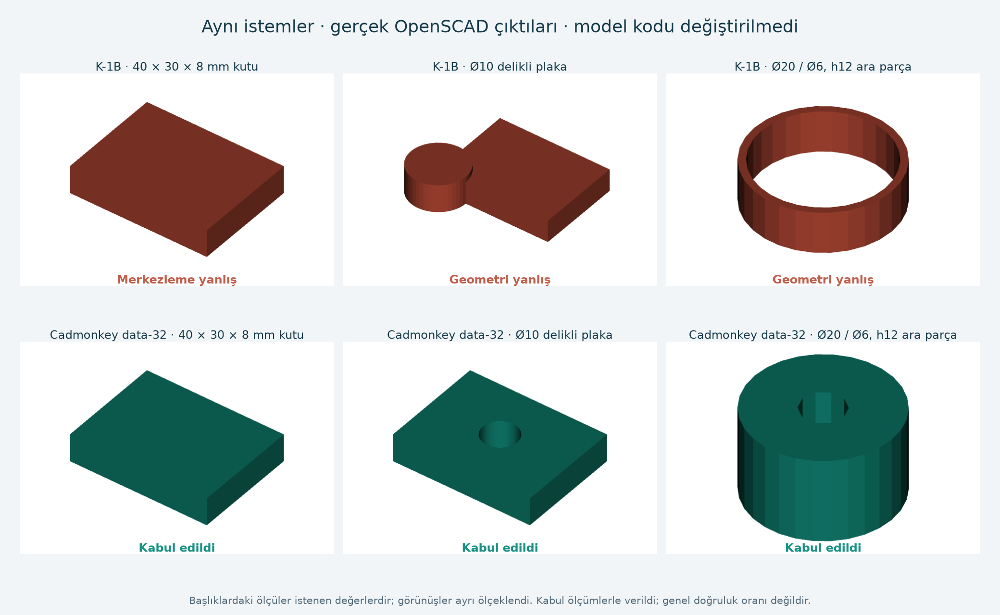
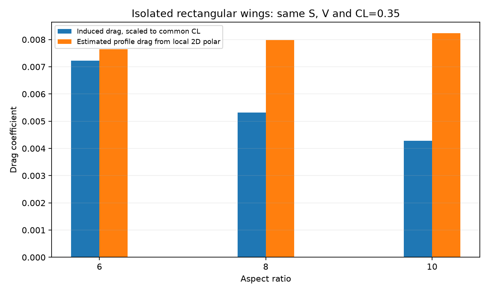
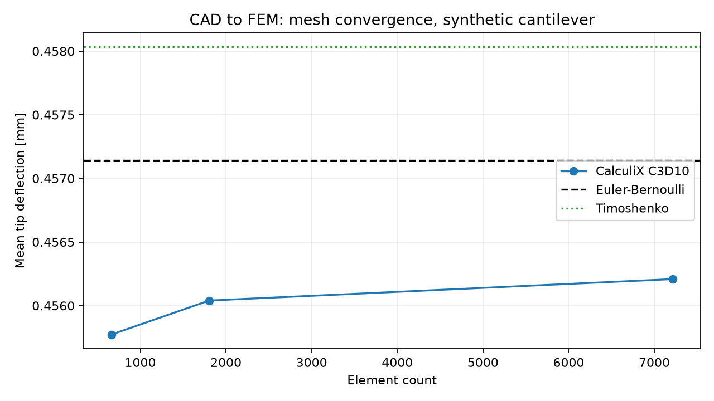

# İHA mühendislik çalışma alanı ve CAD modeli araştırması

18 Ekim 2026 · Yerel ölçüm ve kaynak denetimi · Son kayıt: 2026-10-18T18:09:28.912845+00:00

**Proje bugün, doğal dille verilen bir görevi dosyaya kaydedip gerçek CAD ve analiz araçlarıyla yürütmeye olanak sağlıyor. Yeni bulunan Cadmonkey data-32 basit parçalarda eski K-1B'den belirgin iyi çıktı. Gerçek İHA'nın kavramsal tasarımı ise güncel görev ve bileşen verileri bekliyor.**

Bu rapor kurulan sistemi, gerçekten çalıştırılan örnekleri ve kullanım sınırlarını birlikte açıklar. Önceki fiziksel çözümler bu araştırma için tekrar çalıştırılmadı; yedi kanıt dosyasının SHA256 değeri önceki kayıtla karşılaştırıldı ve tümü eşleşti. Yeni model çalışmaları bu turda gerçek programlarla yürütüldü. [Kaynak ve kanıt denetimi](research_evidence.json).

## 1. Söylediğin modelde yeni ne buldum?

Reddit'teki çalışma, [MakeMe](https://github.com/ThomasVuNguyen/MakeMe) uygulaması ve Gemma tabanlı yaklaşık 1 milyar parametreli K/Cadmonkey ailesi. Metinden OpenSCAD programı, oradan STL/OBJ üretiyor. Zero-To-CAD-1m ise ayrı bir veri kümesi; aynı model değil.

Geliştiricinin model listesini ve eğitim deposunu daha geniş inceleyince **cadmonkey-1b-data-1/2/4/8/16/32** sürümlerini buldum. Data-32 GGUF, eski K-1B paketinden sonra 10 Aralık 2025'te güncellenmiş. “32” burada sürüm adının parçası; 32 milyar parametre anlamına gelmiyor. Kaynak: [geliştiricinin listesi](https://huggingface.co/ThomasTheMaker), [data-32 model deposu](https://huggingface.co/ThomasTheMaker/cadmonkey-1b-data-32), [Q8 dosyası](https://huggingface.co/ThomasTheMaker/cadmonkey-1b-data-32-gguf).

Yeni Q8_0 ağırlık dosyasını kurdum: **1.069.305.984 bayt, yaklaşık 1,07 GB**. Sürüm bbdf3ec07e701885716ac8b188ecd6ff3e9eabed; SHA256 825d80c42cdd2779d16ead1879241acc19f73b1d14accf29c8bbde4cecb58b76 upstream kayıtla eşleşti. Bu kontrol dosyanın doğru indirildiğini gösterir; çizim doğruluğu ayrıca ölçüldü.

### Kullanımı doğru muydu? Yeniden kontrolün sonucu

**İlk üç başarısız denemeden bütün model ailesi hakkında sonuç çıkarmak eksik olurdu.** Hem sürüm hem istem biçimi önem taşıyor. Şu kontrolleri yaptım:

- MakeMe kaynak kodundaki başlangıç “Hey cadmonkey, make me …”; eğitim kodundaki başlangıç “hey cadmonkey, create me a …”. İkisini de denedim. İstemler İngilizce; doğrudan Türkçe üretim başarısı burada ölçülmedi. [MakeMe kaynak kodu](https://github.com/ThomasVuNguyen/MakeMe/blob/main/main.go), [eğitim kodu](https://github.com/ThomasVuNguyen/K/blob/main/train/train.py).
- Kurulu K-1B sohbet şablonu kaynak dosyayla aynı. Data-32 de aynı şablonu taşıyor. Kaynaktan alınan şablonu ayrıca dosya olarak yükleyip iki modelde birer deterministik istem çalıştırdım: **otomatik şablonla üretilen kodla bire bir eşleşti**. Şablon uyuşmazlığı bulmadım.
- İlk T=0,8 denemesinde native çalıştırıcının ek min-p filtresi ve 64 tokenlık tekrar penceresi açıktı. Bu, geliştiricinin Python üretim yolunun bire bir kopyası değildi. Ayrı kontrolde min-p kapatıldı, tekrar penceresi tüm bağlamı kapsadı ve sıcaklık/top-k/top-p sırası açıkça seçildi. T=0,8, top-p=0,95, top-k=64 ve tekrar cezası 1,1 ile iki seed kullanıldı. Sonuç: **K-1B 0/6, data-32 5/6**. [Ayar ve kullanım denetimi](model_usage_audit.json).
- MakeMe'nin eğri çözünürlüğü olan fn=100, fs=0,1 ve fa=1 değerleriyle önceki **42 parça çıktısı yeniden dışa aktarıldı**. Hiçbir kabul/ret sonucu değişmedi. Bu örneklerde hatalar yalnız düşük STL çözünürlüğünden kaynaklanmıyordu.
- “Yalnız OpenSCAD kodu üret” ekini kaldırıp altı yeni parçayı yeniden denedim: **K-1B 0/6, data-32 2/6**. Data-32 iki kutuya istenmeyen kesikler ekledi. Daha kısa veya daha uzun talimatın daima daha iyi olduğu söylenemez.
- Geliştiricinin kutu, kahve kupası ve kedi örnekleri aynı kısa istemlerle denendi. İki modelde kutu ve kupa STL oluşturdu; bu, şeklin bütün beklentileri karşıladığına ilişkin ölçüm değildir. Kedi için 2048 token sınırını ayrıca 8192'ye yükselttim: K-1B: OpenSCAD sözdizimi hatası; data-32: 45 saniyelik dışa aktarma sınırı doldu. Süre sınırında kalan dışa aktarımı geometri hatasıyla bir tutmadım. [Token bütçesi kontrolü](cat_budget_audit.json).

**Kalan belirsizlik:** Bu denetim Windows/native Q8 yolunu kapsıyor. Özgün BF16 ağırlıklarıyla Hugging Face/Unsloth çalıştırması bire bir tekrarlanmadı. Aynı seed, farklı kütüphanelerde aynı rastgele token dizisini garanti etmez. Dolayısıyla “model her koşulda doğru kullanıldı ve bütün hatalar kesin modelden” iddiası yok; buna karşılık yalnız rastgele bir istem denenip olumsuz hüküm de verilmedi.

Depodaki güncel örnek eğitim ayarı 16 veri kaynağı, 4096 bağlam ve Gemma-3-1B üzerinde LoRA kullanıyor. Bu tarifin her yayımlanmış checkpoint'in tam tarifi olduğu belgelenmiyor. Erken veri filtrelerinden biri yalnız OpenSCAD'in boş olmayan STL oluşturmasını denetliyor; ölçü/delik kabulü yapmıyor. Bu bulgu tüm veri setinin denetimsiz olduğunu kanıtlamaz, fakat çalışabilir kod ile mühendislik doğruluğunu ayırmamızın nedenini gösterir. [Eğitim ayarı](https://github.com/ThomasVuNguyen/K/blob/main/train/config.json), [incelenen filtre](https://github.com/ThomasVuNguyen/K/blob/main/data/v6/filter.py).

### Aynı üç parçada kontrollü karşılaştırma

Kutu: 40×30×8 mm, merkezli. Plaka: aynı boyutlarda, Z ekseninde merkezde Ø10 delik. Ara parça: dış Ø20, iç Ø6, yükseklik 12 mm. Kodlara insan düzeltmesi uygulanmadı. İki model de Q8_0, aynı llama.cpp b11719; her deneme ayrı süreç ve kayıt.

| Koşul | Eski K-1B | Yeni data-32 |
|---|---|---|
| MakeMe başlangıcı, T=0 | 0/3 | 3/3 |
| Eğitim kodundaki başlangıç, T=0 | 0/3 | 3/3 |
| İlk örnekleme deneyi, T=0,8; iki seed | 0/6 | 5/6 |
| Ek ölçü kuralları, T=0 | 1/3 | 2/3 |

Tablodaki ilk örnekleme koşulu native varsayılanları içerir; daha yakın kaynak tarifiyle yapılan ek karşılaştırma yukarıda ayrı verildi. **Ek kurallar her zaman iyileştirmedi:** data-32 bir kutuya gereksiz kesik ekledi; örneklemeli bir plakanın deliğini yanlış eksene çevirdi. Açıklamalarında doğru eksen yazması, geometrinin doğru olduğu anlamına gelmedi.

İlk hazırlık koşusunda eğitim başlangıcı birleştirilirken yinelenen “a” oluşmuştu. Bu dil hatasını düzelttim ve 30 koşunun tamamını yeniden çalıştırdım; bu tablonun sayıları düzeltilmiş istemlerden geliyor. [İlk hazırlık kaydı](../simulations/k_family_20261018_204501/study_results.json) saklandı ve ana sonuçlara katılmadı.

30 denemenin tümünde model çalıştı ve STL oluştu. Bütün geometri ölçütlerini geçen deneme sayısı K-1B için 1/15, data-32 için 13/15. Aynı üç şartname farklı ayarlarda tekrarlandığından bunları bağımsız 15 görev veya genel başarı oranı saymıyorum. [Ölçümler](k_family_study.json).

### Önceki üçünden farklı altı görev

Sabit T=0, seed=42 ve eğitimdeki istem başlangıcı kullanıldı. Eğitim kümesiyle örtüşme bilinmiyor; bu görevler eğitimden bağımsızlığı kanıtlanmış bir test kümesi değil.

| İstenen parça | K-1B | data-32 |
|---|---|---|
| 72×24×5 mm merkezli kutu | kaldı | geçti |
| 19×17×11 mm merkezli kutu | kaldı | geçti |
| 60×40×6 mm plaka, merkezde Ø8 delik | kaldı | geçti |
| 54×36×4 mm plaka, X=12 mm konumunda Ø6 delik | kaldı | kaldı |
| 60×24×4 mm plaka, X=±15 mm konumunda iki Ø4 delik | kaldı | kaldı |
| Ø26 / Ø10, yüksekliği 7 mm merkezli ara parça | kaldı | geçti |

**Data-32 4/6; K-1B 0/6.** Kaçık delikte data-32 deliği X=12 yerine merkezde açtı. Çift delikte iki Z deliği yerine X/Y yönünde kesikler oluşturdu. Kaçık delikli plakanın dış ölçüleri ve hacmi kabul aralığındaydı; delik konumu sorgusu hatayı yakaladı. Yalnız hacim kontrolünün yeterli olmadığını somut olarak gördük. [Yeni görevler ve ölçümler](k_family_new_tasks.json).

Kabul: dış ölçü ve hacimde %1'den küçük hata, istendiğinde 0,001 mm'den küçük merkez sapması, delik iç/dış örnek noktaları ve kapalı/manifold STL. Bu kontroller tam geometrik eşdeğerlik, toleranslandırma veya imalat onayı değildir. Yeni deliklerde kalınlık boyunca birden fazla derinlik sorgulandı.

Bu 42 kısa üretimde data-32'nin çalıştırıcıca bildirilen hızı 188,0–226,8 token/s; yükleme dahil üretim süresi 1,77–2,35 s. OpenSCAD dışa aktarımı buna dahil değil. Önbellek/soğuk başlangıç ve tepe VRAM ölçümü yapılmadı; hız doğruluk güvencesi sayılmadı.

### Zero-to-CAD için kullanım denetimi

[Modelin resmi örneği](https://huggingface.co/ADSKAILab/Zero-To-CAD-Qwen3-VL-2B) sekiz temiz 256×256 görüntü, belirli bir sistem istemi ve 4096 yeni token kullanıyor. İlk denemede sistem/kullanıcı metni ve görüntü sayısı buna uygundu; fakat görüntüler bizim oluşturduğumuzdu ve T=0,2 kullanılmıştı.

Yeniden denemede **resmi test kümesinden tek bir örneğin image_0…image_7 görüntüleri özgün sıra ve boyutlarıyla** alındı; örnek kod çalıştırılmadı. Aynı metin ve açgözlü üretimle 4096 token denendi. Özgün örnekte tekrarlayan kod token sınırında açık parantezle kaldı. Yerel plaka görüntülerinde Python sözdizimi geçti ama CadQuery lineTo çağrısı eksik argüman nedeniyle çalışmadı. GGUF sohbet şablonu upstream metadata ile eşleşiyor. [Girdi, kod ve loglar](zero_usage_audit.json).

Bu sonuç **mevcut üçüncü taraf Q6_K + f16 görsel bağdaştırıcı/native bağlantısının henüz doğrulanmadığı** anlamına geliyor. Özgün BF16 modelin genel başarısı hakkında olumsuz hüküm vermiyorum. Model kartındaki tam değerlendirme burada tekrarlanmadı; nicemleme, çalıştırıcı/görsel ön işleme ve özgün modele geçişle ayrıştırılması gereken belirsizlik sürüyor.

### Projede kullanım kararı

Data-32, kontrol edilen basit parçalarda önceki K-1B'ye göre daha uygun **deneysel yerel taslak yardımcısı**. Serbest biçimli yüzeyler, karmaşık montaj veya İHA kanadı mühendisliğini kendi başına yapabildiği gösterilmedi. Çıktısı kaynak program ve STL olarak saklanabilir; STEP/FreeCAD aktarımı ayrıca doğrulanır. Ana yöntem, ajanın açık parametrelerle CadQuery/FreeCAD/OpenVSP çalıştırması ve mühendislik hesabını ayrı çözücülerle yapması olmaya devam ediyor.

CADmium, CAD-Recode, Text2CAD ve CAD-Coder önceki araştırmada değerlendirildi; burada kurulup ölçülmüş alternatifler değiller. Görevleri ve temsil biçimleri farklı. Bu turda aynı model ailesinin daha yeni küçük sürümünü gerçekten denemek daha somut sonuç verdi. [Önceki alternatif araştırması](cad_model_research.md).

## 2. Projede bugüne kadar ne kuruldu ve yapıldı?

| Alan | Kurulan / bağlanan araç | Gerçek kanıt |
|---|---|---|
| Hesap, girdi ve temel aero | Python 3.12.14; AeroSandbox 4.2.10, NeuralFoil 0.3.3, CasADi 3.8.1 | 26/26 kontrol; [kayıt](test_results.json) |
| Uçak geometrisi ve potansiyel akış | OpenVSP 3.55.0 / VSPAERO 7.2.2; native program/AngelScript | Gerçek çalıştırmalar, referanslar, yük dağılımı ve panel/wake kontrolleri |
| Viskoz profil analizi | XFOIL 6.99 | Re, Mach, Ncrit, geçiş koşulları ve yakınsamayan açıları kayıtlı |
| Parametrik CAD ve çizim | CadQuery 2.8.0, FreeCAD 1.1.4, OpenSCAD 2021.01 | STEP tekrar okuma, katı/yüzey ayrımı, gerçek üç görünüş SVG/DXF |
| Birleşik aero/CAD bağlantısı | OpenVSP + XFOIL + CAD | 26/26 kontrol; [kayıt](external_test_summary.json) |
| Sonlu elemanlar | Gmsh SDK 4.15.2 / CalculiX 2.22 / FreeCAD | 14/14 kontrol; [kayıt](fem_results.json) |
| Dosyadan yönetilen kanat karşılaştırması | VSPAERO yükleri + XFOIL polar eşleştirmesi | 27/27 yöntem kontrolü; [kayıt](wing_study_results.json) |
| Küçük yerel CAD modelleri | K-1B Q8_0, Cadmonkey data-32 Q8_0, Zero-to-CAD 2B Q6_K + f16 | Çalıştırma ve geometri ayrı kaydedildi; otomatik mühendislik kabulü kapalı |
| Görev ve proje düzeni | Yerel Mühendislik Merkezi, görev/girdi dosyaları, AGENTS.md, proje becerisi | Görev durumu, giriş/rapor SHA256 ve ham log düzeni |

İki Python ortamı ayrıldı; paket sürümleri ve indirme özetleri kilitlendi, bağımlılık kontrolleri geçti. FreeCAD profili proje içinde tutuldu. Sistem PATH'i ve kalıcı Windows çalıştırma ilkesi değiştirilmedi. OpenVSP Python bağlaması kurulmadı; gerçek native programları kullanıyoruz. FreeCAD içindeki Gmsh arayüz ikilisi 4.15.0, sayısal ağ SDK'sı 4.15.2.

### CAD ve teknik çizim

OpenVSP'de uçak görünümlü bir test geometrisi, ayrıca referans kanat ve üç AR adayı üretildi. VSP3 ve STEP dosyaları var. Test uçağının STEP'i geçerli **38 yüzey, 0 katı** içeriyor; imalata hazır kapalı uçak katısı değil. Ayrı oluşturulan NACA kanat zarfı kapalı katı olarak kontrol edildi ve STEP'ten yeniden açıldı. Üst/yan/ön görünüşlerde OpenCascade gizli çizgi hesabından SVG/DXF alındı; DXF'ler tekrar okundu. Ölçülendirilmiş toleranslı üretim resmi henüz hazırlanmadı.

Eski K-1B'nin hatalı üç taslağını bu Codex çalışması düzeltti. Gerçek OpenSCAD ve ayrı CadQuery→STEP yoluyla **3/3** geometri kontrolü geçti. Bu düzeltmeler küçük modelin kendi başarısı sayılmadı. [Kontrollü parçalar](../cad/checked_parts/), [doğrulama](checked_parts_results.json).

### Aerodinamik

Referans dikdörtgen kanatta üç panel düzeyi, wake kuvvet değişimi ve bağımsız AeroSandbox karşılaştırması yapıldı. OpenVSP test uçağında çizilmiş gövde aerodinamik kümeye dahil edilmedi; tüm uçağın gövde sürüklemesi çözülmüş sayılmaz. Kanat-kuyruk testinin ayrıca tüm geometri için panel yakınsaması yapılmadı.

Dosyadan yönetilen yeni deney **düz, burulmasız, dikdörtgen NACA0012 izole kanatlar** için. Varsayımlar: S=0,50 m², V=30 m/s, hedef CL=0,35; AR=6/8/10. Geometriye göre Re yeniden hesaplandı, iki panel düzeyi ve wake değişimi kontrol edildi. XFOIL Ncrit=9, geçiş üst/alt x/c=1 koşullarında çalıştırıldı; AR=8'de +2°, AR=10'da −2° yakınsamadı ve saklandı. Poların yakınsamış aralığında yaklaşık eşleştirme yapıldı. [Girdiler](../data/wing_study_case.json).

| AR | Açıklık m | Veter m | Re | Ortak CL için CDi | Yaklaşık profil CD |
|---|---|---|---|---|---|
| 6 | 1,732 | 0,289 | 592870 | 0,00722 | 0,00765 |
| 8 | 2,000 | 0,250 | 513440 | 0,00531 | 0,00798 |
| 10 | 2,236 | 0,224 | 459235 | 0,00428 | 0,00823 |

Bu sonuçlar test koşullarında aday karşılaştırmasına yarar. Tüm uçak sürüklemesi, stall/CLmax, güç, süre, trim veya kararlılık kanıtı değildir. XFLR5'in bütün özelliklerinin ve iş akışlarının eşdeğerini kurduğumuzu söylemiyorum; profil ve taşıyıcı yüzey analizinin ilgili bölümleri çalışıyor. Tam viskoz CFD/ayrılma çözümü kurulmadı.

### Yapısal analiz

Gerçek zincir: FreeCAD modeli → STEP → Gmsh ikinci dereceden tetra ağ → CalculiX çözümü. Sentetik test 200×10×10 mm ankastre kiriş; E=70 GPa, nu=0,3, uç yüzde toplam 10 N. Analitik hesap SI, native CAD/FE mm–N–MPa dönüşümü açık.

İnce ağ: 13208 düğüm, 7261 C3D10 eleman. Ortalama uç sehim **0,456204 mm**; Euler–Bernoulli **0,457143 mm**, fark **%0,205**. Orta–ince ağ sehim değişimi **%0,036**. Üç ağda kuvvet dengesi kontrol edildi. İlk aktarımda yakalanan kenar düğümü sıralama hatası düzeltildi; başarısız ham kayıt korundu. [FEM ölçümleri](fem_results.json).

Bu çalışma izotropik doğrusal bir kirişte araç zincirini doğrular. Gerçek kanat malzemesi, kompozit katmanlar, bağlantılar, burkulma, yorulma, aeroelastisite veya dayanım marjı çözülmedi. Sehim yakınsaması, gerilme yakınsaması diye sunulmadı.

## 3. Bugün neler yapılabilir, neler ek çalışma ister?

| İstek | Bugünkü olanak | Gerekli sınır / ek iş |
|---|---|---|
| Ölçüleri belli basit parça çiz | CadQuery/FreeCAD/OpenSCAD ile gerçek dosya oluşturma ve kontrol | Delik/katı/ölçü kabulü her görevde tekrar |
| Küçük yerel modele çizdir | Data-32 taslak üretimi çalışıyor | Model çıktısı otomatik doğru sayılmaz; karmaşık yerleşimde hata var |
| Parametrik uçak/kanat geometrisi üret | OpenVSP VSP3, STEP; üç görünüş | Gerçek yerleşim ve parametreler görev için tanımlanmalı |
| Profil ve düşük açılı kanat adaylarını karşılaştır | XFOIL, VSPAERO, AeroSandbox ve mevcut karşılaştırma hattı | Yeni profil/süpürme/burulma için geometri ve yöntem yeniden uyarlanmalı |
| Basit elastik yapıda sehim/kuvvet çöz | FreeCAD→Gmsh→CalculiX bağlantısı çalışıyor | Her gerçek parçanın malzemesi, yükü, mesneti ve yakınsaması kurulmalı |
| Görevleri ve sonuçları izlenebilir tut | Girdi, görev, ham çıktı, SHA256 ve rapor düzeni var | Kaynağın veya fiziksel kabulün doğruluğu salt dosya varlığıyla kanıtlanmaz |
| İHA'nın kavramsal niceliklerini çıkar | Araçlarla yürütülebilir; sekiz adımlı kayıt hazır | Güncel gereksinim ve bileşen verileri eksik |
| Sürekli hız/güç/enerji/süre, CG/trim/kararlılık bütünü | Henüz tamamlanmış genel otomatik tasarım hattı yok | İtki/power verisi, kütle/yerleşim ve ilgili hesap modülleri gerekir |
| Kompozit kanat, uçuşa elverişlilik, üretim onayı | Henüz değerlendirilmedi | Göreve özel kapsam, doğrulama ve fiziksel test gerekir |
| ANSYS | Kurulmadı | Ağır kurulum/lisans aşaması sona bırakıldı |

AGENTS.md ve beceri çalışma sırasını, kanıt beklentisini ve eksik girdiyi nasıl ele alacağımızı tanımlıyor. Bunlar her mühendislik kontrolünü otomatik yapan bir ispat sistemi değil. Mevcut programlarda bazı girdi, birim, geometri ve yakınsama kapıları var; her yeni görevin fiziksel kabulü ayrıca kurulmalı. Halüsinasyonsuzluk garantisi verilmiyor.

## 4. Normal sohbetten bu proje akışına nasıl geçiyorsun?

1. [Muhendislik-Merkezi.cmd](../Muhendislik-Merkezi.cmd) dosyasını aç; görevini yazıp “Ajanla çalışmaya başla” düğmesine bas. Aynı görevi bu Codex sohbetinde de verebilirsin.
2. Merkez isteği bir görev kaydına yazar ve kurulu Codex'i bu klasörde başlatır. Ajan proje kurallarını, güncel girdileri ve önceki kanıtları okuyarak uygun programları kullanır.
3. Ajan yeni girdi/çalıştırma klasörü oluşturur; CAD/analiz, kabul kontrolleri, eksikler ve rapor birlikte kaydedilir. [Birleşik proje görünümü](../Proje-Ozeti.html) üzerinden sonuçlara ulaşılır.

Ek bir mühendislik modeli eğitilmedi. Merkez, klasör ve araçları bir araya getiren yerel bir başlatıcıdır; ana planlama ve görev yürütme Codex'te olur. Küçük CAD modelleri bunun yardımcı araçlarıdır. Yerel ağırlık üretimi çevrimdışı yapılabilir; bu kurulumdaki ana Codex oturumu bulut modelini kullanır.

Merkezin Windows penceresi önceki turda gerçekten açıldı. Görev başlatma komutunun yolu kontrol edildi; bu kontrol için ikinci bir LLM seansı otomatik açılmadı. Bu araştırma ve önceki mühendislik çalışmaları ise mevcut ajan oturumundan gerçek araçlarla yürütüldü. Arayüz düğmelerindeki hazır testler mevcut örnekleri çalıştırır; her serbest mühendislik isteği için hazırlanmış ayrı bir otomatik uygulama yok.

[Başlangıç kılavuzu](../Baslangic.md) kullanım ayrıntılarını içerir. Merkezin “Yerel CAD modelleri” düğmesi eski K/Zero denemesini çalıştırır; yeni karşılaştırmalar bu sohbetten veya tek komut girişindeki k-family, cad-parts ve model-usage gruplarından yürütülür. Yeni ağırlık kendiliğinden mühendislik karar vericisine çevrilmedi.

## 5. Gerçek İHA projesinin durumu ve sıradaki adım

Güncel görev dosyasında görev türü, hedef hız, süre, faydalı yük, irtifa, kalkış/iniş ve boyut kısıtı henüz girilmedi. Altı bileşen grubunun kütlesi bilinmiyor. Eski sohbet hedefleri bu klasöre yeni gereksinim olarak otomatik aktarılmadı; test uçağı seçilmiş gerçek tasarım sayılmadı.

Kavramsal sekiz adımın tümü bekliyor: gereksinimler; kaynak/girdi/belirsizlik; kütle; kanat/düşük hız; sürükleme/güç/enerji/süre; yerleşim/CG/trim/kararlılık/yapı; tutarlılık/duyarlılık; aday karşılaştırması. [Adım kaydı](../data/project/conceptual_steps.json).

**Bir sonraki yüksek değerli iş:** güncel İHA görevini ve bileşen listesini kaynaklarıyla [görev girdilerine](../data/project/mission.json) ve [kütle bütçesine](../data/project/mass_budget.json) geçirmek. Tamamlanma ölçütü: her gereksinimde birim/kaynak/kabul ölçütü; her bileşende ölçülmüş veya kaynaklı kütle ya da gerekçeli aralık; bilinmeyenlerin açık kalması. Bu kayıt kurulduktan sonra araç zinciri gerçek adaylara uygulanabilir.

## Kanıt dosyaları

- [Model kullanım denetimi](model_usage_audit.json): istemler, örnekleme, açık şablon ve 42 çözünürlük kontrolü.
- [Karşılaştırma](k_family_study.json) ve [yeni görevler](k_family_new_tasks.json): özgün kod, STL, ölçüler ve komut dosyalarına bağlantılar.
- [Zero kullanım denetimi](zero_usage_audit.json): özgün veri kümesi görüntüleriyle yerel Q6 bağlantısı.
- [Önceki araç zinciri raporu](engineering_toolchain_report.md), [aero/CAD raporu](external_tools_report.md), [kanıt özeti](verification_summary.json).
- [Proje durumu](project_status.json), [kaynak ve hash kaydı](research_evidence.json).

Raporun kapsamı: kurulu araçların gösterilmiş yetenekleri ve deneysel model değerlendirmesi. Gerçek uçak fizibilitesi henüz değerlendirilemedi.
